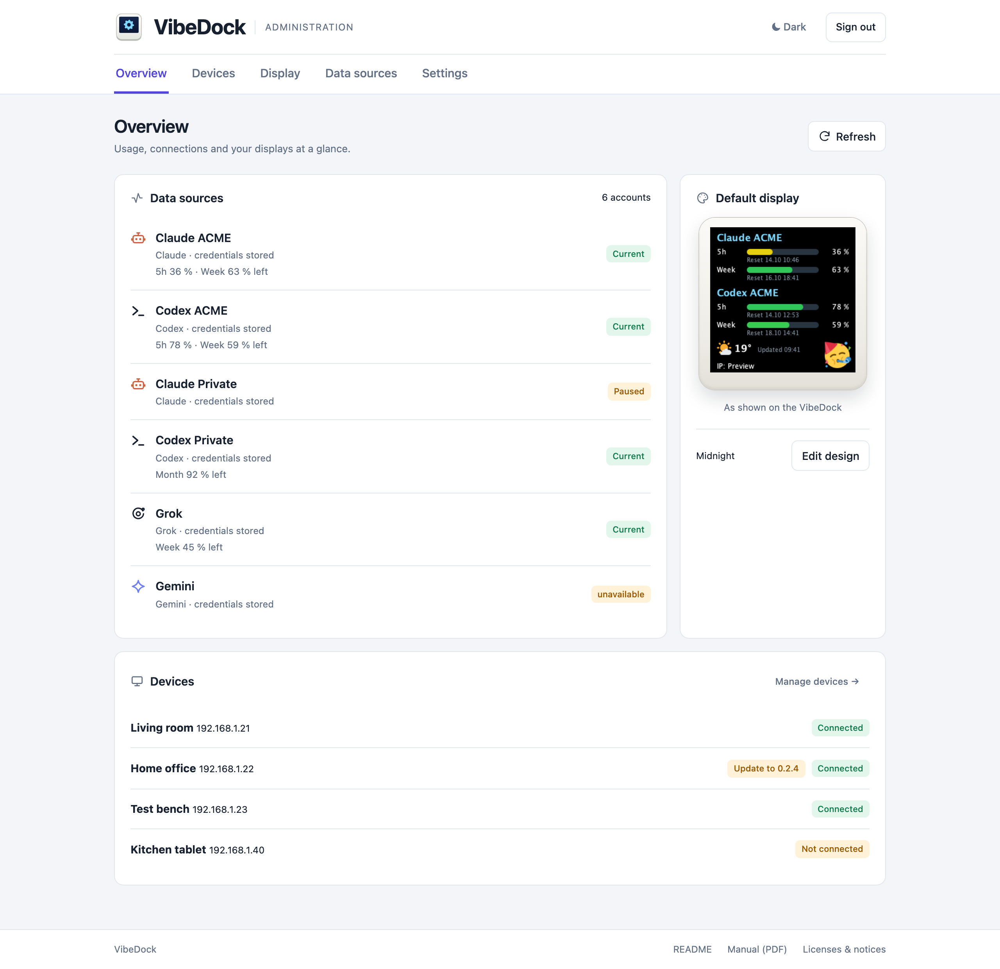
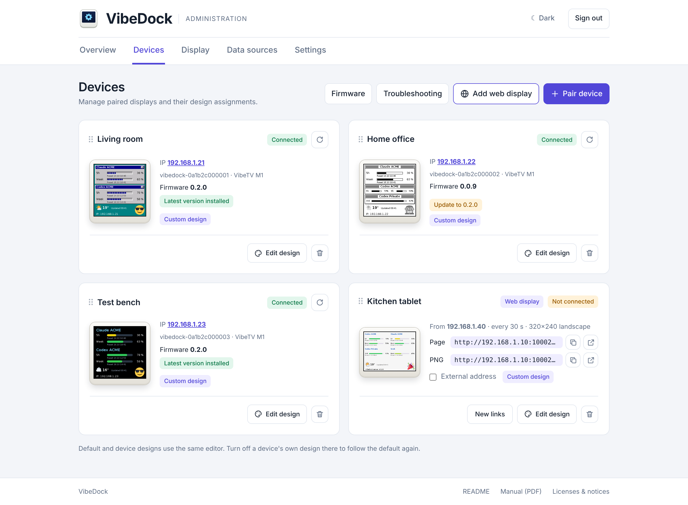
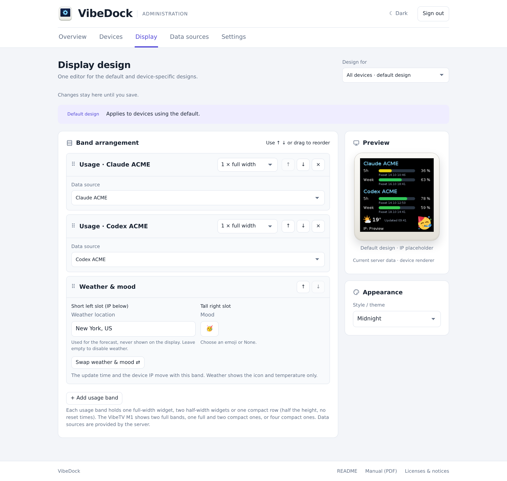
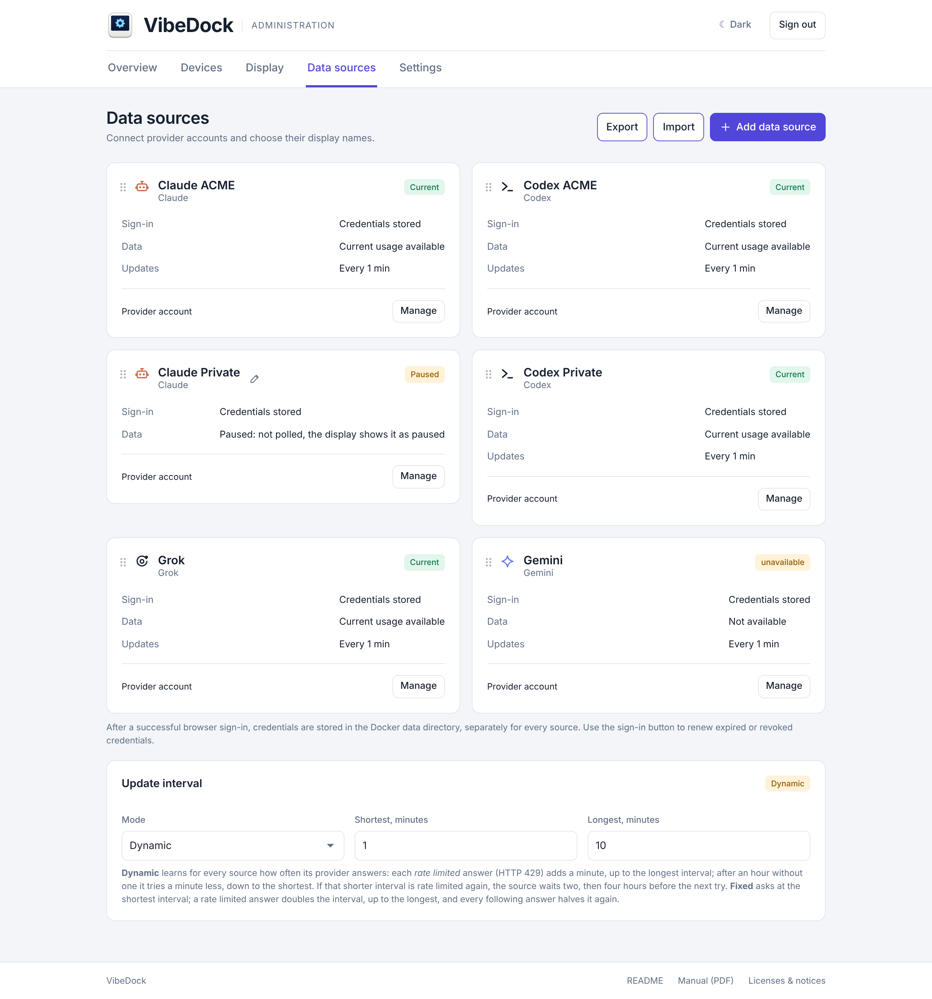
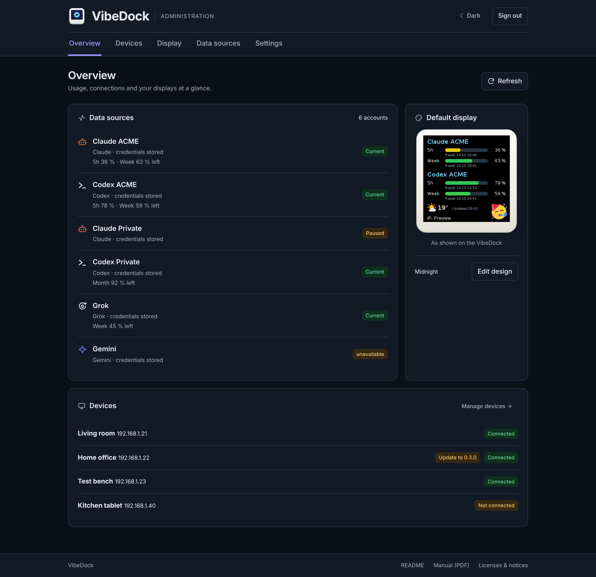
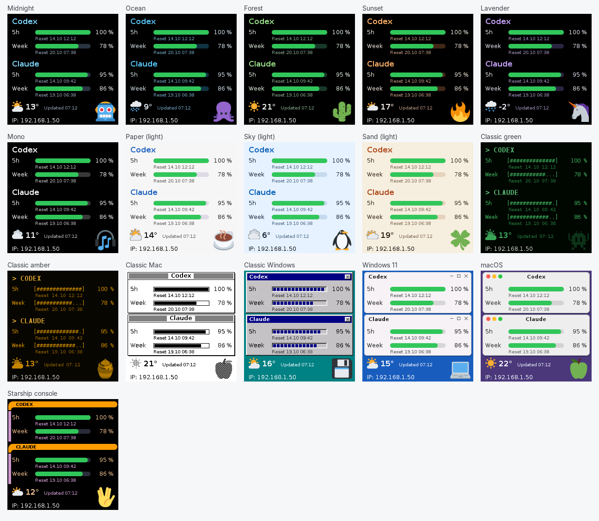

<p align="center">
  
</p>

<h1 align="center">VibeDock</h1>

<p align="center">
  A self-hosted usage display for Codex, Claude, Cursor, Grok and Gemini accounts — on a small ESP8266 or ESP32 desk screen, or in a browser.
</p>

<p align="center">
  <a href="https://github.com/McFcologne/org.frifra.vibedock">Repository (private)</a> ·
  <a href="vibedock-server/README.md">Server setup & administration</a> ·
  <a href="vibedock-client/README.md">Client firmware</a> ·
  <a href="vibedock-server/PROVIDERS.md">Providers</a> ·
  <a href="vibedock-client/FLASHING.md">Backup & flashing</a>
</p>

<p align="center"></p>
<p align="center"><sub>Current administration UI with isolated demo accounts and devices. No live credentials or usage data are shown.</sub></p>

> **Hobby project, use at your own risk.** VibeDock is an independent hobby project, built for fun and provided
> "as is" without warranty of any kind. To the extent permitted by law, the authors accept no liability for damage
> from installing, flashing or running it, including bricked devices, lost data or security problems. It is not
> affiliated with Vibe TV ([vibetv.shop](https://vibetv.shop/)), which sells the display hardware, nor with any AI
> provider. Details: the [disclaimer in the user manual](docs/manual/MANUAL.md#disclaimer) and sections 7 and 8 of
> the [Apache License 2.0](LICENSE).

## What VibeDock does

VibeDock shows how much of your AI coding quota is left (Codex, Claude, Cursor, Grok, Gemini) on a small extra display
next to your screen, so you see the 5-hour and weekly limits and their reset times at a glance instead of opening each
provider's page. One self-hosted server, e.g. in Docker on a NAS, signs in to the providers, collects the usage of all
accounts and draws the image for every display. All displays are managed centrally in its web administration: pair
them, choose what each one shows and how it looks, and update their firmware over Wi-Fi. Besides the VibeTV M1 desk
display, ESP32 boards with a display and any browser or tablet can serve as a display. Provider credentials stay on the
server; a display only receives its image.

### Features

- **Several accounts per provider.** Keep personal and work accounts separate, give each source its own display name, and assign sources to the display independently of their provider.
- **One design editor for defaults and devices.** Devices follow the default until you enable a complete custom design. Return to the default at any time.
- **Up to eight usage widgets.** Stack up to four usage bands and the weather/mood band in any order. Each usage band holds one full-width source, two half-width sources or one compact row; the VibeTV M1 fits two full bands, one full and two compact ones or four compact ones.
- **Display types.** Designs adapt to the display of each device: VibeTV M1 (240×240) by default, other common SPI panels from 128×160 to 320×240 per device.
- **Weather and mood.** Show an emoji and weather icon/temperature; swap their slots, including the slot sizes. The update time and device IP stay with their band and cannot be hidden. The weather location is never drawn.
- **Thirteen display themes.** Modern dark and light themes, classic green/amber terminals, classic Mac and classic Windows. Previews and devices use the same server renderer.
- **Encrypted account transfer.** Export data sources with their saved sign-ins and restore selected sources by adding them or replacing the current collection.
- **Device management.** Pair using the IP and six-digit code, inspect status and previews, rename, reorder by dragging, force a redraw, update, or remove a device.
- **Boards.** Besides the VibeTV M1 (ESP8266), the firmware builds for ESP32, ESP32-S3 and ESP32-C3 boards with a display (not yet tested on hardware); each device has a board that decides which firmware it gets.
- **Web displays.** A browser, tablet or another program shows the image without hardware: a full-screen page that reloads itself, or a plain PNG link, protected by a secret in the link.
- **Firmware from the server.** The Docker image carries the matching display firmware for every board: download it, install it from Chrome or Edge over USB and pair the display over the same cable in one go, or update paired displays over Wi-Fi with firmware signed by the server.
- **Responsive administration.** Five navigation areas, remembered light/dark appearance, forms that open on demand, explicit save/discard in the design editor, and a footer with build version, README and generated license information.

The Java 21 / Spring Boot server collects usage, renders an image in each device's resolution (240×240 for the VibeTV M1) and handles provider credentials. The firmware (ESP8266 or ESP32 with an SPI display) manages Wi-Fi and pairing, pulls the image and draws it, scaled to its screen. Provider credentials never go to a device.

## Supported data sources

| Provider | Setup | Displayed quota |
| --- | --- | --- |
| Codex | Sign in through the official Codex CLI | Short and long usage windows, usually 5 hours and a week; other plans are matched by duration |
| Claude | Sign in through Claude Code, including supported SSO flows | 5-hour and weekly windows |
| Cursor | Team Admin API key and member e-mail | Member's share of the billing-period limit; individual subscriptions are not supported |
| Grok | Device-code sign-in through Grok Build | Weekly or monthly credit pool |
| Gemini | Google sign-in through Gemini CLI | Daily Code Assist quota of the model with the least remaining share; accounts requiring a custom Cloud project are not supported yet |

The screen shows **remaining** usage and reset times. Missing readings show `--`, not invented zeroes. The read-only JSON API reports **consumed** percentages instead. Internal provider endpoints can change; details and limitations are in [PROVIDERS.md](vibedock-server/PROVIDERS.md).

## Administration

| Area | Available actions |
| --- | --- |
| **Overview** | See each source's remaining usage and collection status, refresh usage, preview the default display and inspect device status (live), and start a pending firmware update. Data sources sit beside the preview; devices are below. |
| **Devices** | Open **Pair device** (IP, code, optional name and board) or **Add web display**; inspect each device's image, board, connection state, firmware and default/custom design live; rename it with the pen, drag cards to reorder them; open its editor; use the reload button (force refresh) or the bin (remove device); start **Update to …** or **Update all** over Wi-Fi. **Firmware** chooses the board, downloads its firmware, flashes it from the browser over USB, pairs a display over USB, restarts it and starts updates. |
| **Display** | Choose the default or a device under **Design for**, enable **Custom design**, choose the display type, add, remove and reorder bands, split usage bands or make them compact rows and pick sources, set weather and mood, swap sides, choose a theme under **Appearance**, then **Save** or **Discard**. Bands the display cannot show are folded below a dashed line. |
| **Data sources** | **Add data source**, drag cards to reorder, rename with the pen, open **Manage** to sign in or configure credentials, pause/resume or remove sources, and use encrypted **Export / Import** with a review before applying. |
| **Settings** | Set internal/external server addresses and poll interval, manage read-only JSON API access and legacy device delivery, and inspect storage availability. |

The administration's light/dark appearance is independent of the display theme. Create forms hide their matching trigger while open; **Cancel** or Escape closes them. Save controls appear when there are changes. The design editor previews without saving and protects unsaved changes when switching devices.

<details>
<summary>Device management</summary>



</details>

<details>
<summary>Shared default and device design editor</summary>



</details>

<details>
<summary>Accounts, sign-in status, export and import</summary>



</details>

<details>
<summary>Dark administration appearance</summary>



</details>

## Display themes

<p align="center"></p>

The default layout remains available unchanged: two full-width usage bands followed by weather/mood, update time and IP. Half-width widgets and a different band order are optional. Current firmware supports moving the entire weather/mood band; the editor warns when older firmware needs it at the bottom.

## Quick start

The repository is private on GitHub; cloning requires access.

```sh
git clone git@github.com:McFcologne/org.frifra.vibedock.git
cd org.frifra.vibedock/vibedock-server
cp .env.example .env
# Set your own ADMIN_PASSWORD in .env; keep an existing .env when updating.
docker compose up -d --build
```

Without building: set `VIBEDOCK_IMAGE=mcfcologne/vibedock-server:latest` in `.env`, then
`docker compose pull && docker compose up -d`. The image is published for amd64 and arm64 with every release, on
Docker Hub (`mcfcologne/vibedock-server`) and on GitHub (`ghcr.io/mcfcologne/vibedock-server`).

| What | Where |
| --- | --- |
| Administration | `http://<host>:10001/admin` (network-wide by default, plain HTTP) |
| Public usage API and device image pull | `http://<host>:10002` |
| Persistent data | `vibedock-server/docker.data/` (plaintext credentials; excluded from Git) |

1. Open **Data sources**, add accounts as needed and use **Manage** to sign in or configure the Cursor team key.
2. Connect the display by USB and open **Devices → Firmware** in Chrome or Edge (administration over HTTPS or on `localhost`): download a full backup, install the firmware and pair it right there with name and Wi-Fi.
3. Without the browser: build and flash with `vibedock-client/scripts/flash.sh` after a backup, connect Wi-Fi with the setup QR code and use **Devices → Pair device** with the IP and code from its screen.
4. Open **Display** to configure the default. Use **Edit design →** on a device when it needs its own design.
5. Set reachable server addresses under **Settings** when needed. The JSON API stays blocked until you explicitly allow readers; this does not block paired devices.

Full instructions: [user manual with screenshots](docs/manual/MANUAL.md) · [server setup and administration](vibedock-server/README.md) · [client setup](vibedock-client/README.md).

## Hardware

VibeDock was developed as independent software for the **VibeTV M1** desk display by Vibe TV ([vibetv.shop](https://vibetv.shop/)),
an ESP8266EX with 4 MB flash and a 240×240 display, and is tested on it. It
replaces the seller's firmware after you have saved a full backup of your own device (see [FLASHING.md](vibedock-client/FLASHING.md));
where to get one is in the [manual](docs/manual/MANUAL.md#getting-a-display).

The same sources also build for several ESP32 boards with a display (Cheap Yellow Display, LilyGO T-Display and
T-Display-S3, Waveshare ESP32-S3-LCD-1.69, ESP32-C3 with ST7789). These builds compile but are not yet tested on hardware;
see the [client README](vibedock-client/README.md).

## Client firmware and local device page

The easiest way is **Devices → Firmware** in the administration (see Quick start). Alternatively build the image and flash over USB, or take the firmware image of your board (`vibedock-m1-<version>.bin` for the VibeTV M1, `vibedock-<board>-<version>.bin` for the others) from a GitHub release of this (private) repository; releases also carry the server JAR and the Docker images for amd64 and arm64. Flash only after creating a verified backup of **your own** device. Instructions: [client README](vibedock-client/README.md#build-and-test) and [FLASHING.md](vibedock-client/FLASHING.md).

```sh
cd vibedock-client
./scripts/build.sh    # compile only; firmware/.pio/build/vibedock-m1/firmware.bin
./scripts/flash.sh    # build, detect the ESP8266 and flash after confirmation
```

The firmware provides QR-based Wi-Fi setup, network scanning, pairing, internal/external server fallback, stale-image protection and a local status page at `http://<device-ip>/`. That page shows state and an image preview and offers persistent gamma/RGB calibration. It is visible on the local network. Power-cycle gestures open Wi-Fi setup or perform a factory reset; see the client README for the exact sequence.

`flash.sh` and the browser flasher write only firmware; saved Wi-Fi and pairing remain on the device. Builds contain no Wi-Fi credentials, device keys or provider tokens. Once installed and paired, displays update over Wi-Fi from the administration: they install only firmware signed with the key of the server they are paired with and keep the running firmware if anything fails.

## Tests and development

From `vibedock-server/`, run the complete server test suite, license-generator test and Chromium browser tests:

```sh
./scripts/verify.sh
```

Requirements: Java 21+, Maven, Node.js 22+ and npm. The first run installs the pinned browser-test dependencies and Chromium. On Linux, use `./scripts/verify.sh --with-deps` for browser system libraries. Browser tests use a new loopback-only server with temporary data and no provider credentials or physical devices. They cover editing, save/discard, inheritance, navigation and desktop/mobile layouts in light/dark modes. These are structural layout checks, not pixel-by-pixel screenshot baselines.

GitHub Actions runs the same checks on pushes and pull requests. [Server testing details](vibedock-server/README.md#automated-regression-checks) · [native client policy test](vibedock-client/README.md#run-the-native-policy-test) · [IntelliJ setup](AGENTS.md).

## Version and license information

The administration footer shows the build version and links to README, the PDF manual and **Licenses & notices**. The dedicated license page displays the Java dependency report generated by Maven and the component notices collected during the Docker build, including the installed CLI dependencies, artwork, fonts and runtime. A local Java installation without a container inventory says so explicitly. VibeDock itself is licensed under the Apache License 2.0 (see [License](#license)).

## Repository layout

| Path | Contents |
| --- | --- |
| [`vibedock-server/`](vibedock-server/README.md) | Server, Docker image, administration, provider integration and automated checks |
| [`vibedock-client/`](vibedock-client/README.md) | ESP8266 firmware, PlatformIO build, calibration and device setup |
| [`docs/`](docs/) | Project logo, current administration screenshots and display examples |
| [`vibedock-server/CLIENT-PROTOCOL.md`](vibedock-server/CLIENT-PROTOCOL.md) | Pairing, image pulls, force refresh, formats and device authentication |
| [`vibedock-server/PROVIDERS.md`](vibedock-server/PROVIDERS.md) | Provider setup, collected windows and limitations |
| [`vibedock-server/VALIDATION.md`](vibedock-server/VALIDATION.md) | Validation evidence and outstanding checks |
| [`vibedock-client/FLASHING.md`](vibedock-client/FLASHING.md) | Full backup, flashing and restore procedure |
| [`VibeDock-Feasibility-Codex-Claude.md`](VibeDock-Feasibility-Codex-Claude.md) | Original feasibility assessment |
| [`CHANGELOG.md`](CHANGELOG.md) | Release notes per version, used for the GitHub releases |
| [`RELEASING.md`](RELEASING.md) | Releases, Docker registries, secrets and repository settings |
| [`AGENTS.md`](AGENTS.md) | IntelliJ setup and development rules |

## Background and credits

- Quota endpoints and fields follow [CodexBar](https://github.com/steipete/CodexBar) 0.63.0 by Peter Steinberger, pinned to commit [`f3e718c`](https://github.com/steipete/CodexBar/tree/f3e718c897d5ed76af4e07182df899c722118546); additional integrations are documented in [PROVIDERS.md](vibedock-server/PROVIDERS.md).
- Provider sign-in uses the official Codex, Claude Code, Grok Build and Gemini CLI clients. Cursor uses its team Admin API.
- Emoji graphics: [Twemoji](https://github.com/jdecked/twemoji) (CC-BY 4.0). Weather: [Open-Meteo](https://open-meteo.com/). Installed component notices are listed in the administration under **Licenses & notices**.
- Display hardware of the VibeTV M1: Vibe TV (see [Hardware](#hardware)). See also the [feasibility assessment](VibeDock-Feasibility-Codex-Claude.md).

## Safety notes

- Create and verify a private full backup of your own device before flashing. Build and test commands never flash hardware.
- Original-firmware redistribution rights have not been established. No manufacturer firmware or device backups are distributed with this project.
- Provider quota endpoints are internal interfaces, not guaranteed public APIs.
- Keep credentials, `.env`, `docker.data/`, source exports and generated build files out of Git. `docker.data/` also holds the firmware signing key (`ota-signing.key`): keep it with your backups; with a new key, displays must be paired again before they accept updates over Wi-Fi.

## License

VibeDock is licensed under the [Apache License 2.0](LICENSE); see also [NOTICE](NOTICE). Third-party components keep their own licenses: the administration lists everything in the Docker image under **Licenses & notices**, the [user manual](docs/manual/MANUAL.md#license) names the most important ones, and the PDF manual of the Docker image ends with every component of that build.
