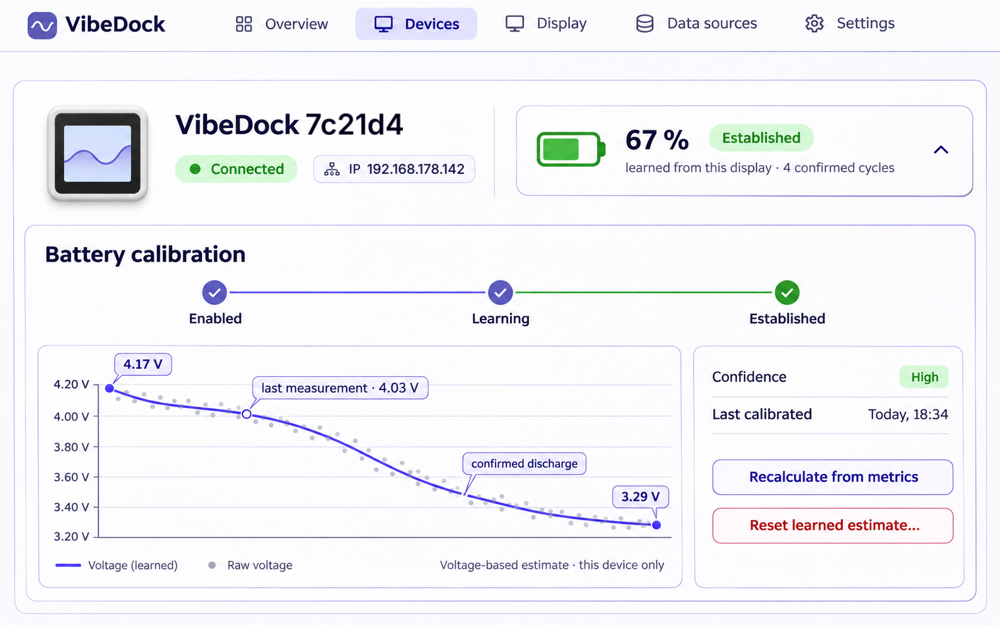

[VibeDock](../../README.md) › **Design: learned battery level UI**

# Learned battery level UI

Status: V1 concept, agreed. It describes the administration UI and the display icon for a server-side, per-display
battery estimate. The learning itself is described in [Design: battery level learned by the server](battery-learning.md);
this page names what the UI shows and what the implementation still has to change (see *Changes to the implementation*).
It does not change firmware behaviour or battery safety.



The picture shows the principle. Its figures are illustrative and not taken from a real curve; it is replaced by a
screenshot of the implementation.

## Purpose

The battery UI must answer three things without making a device card noisy:

1. Does this display support a battery measurement?
2. Is a battery estimate enabled and trustworthy for *this* display?
3. Why is a percentage shown, missing, or no longer current?

The display owner chooses whether to enable an estimate. Boards normally ship without a battery; neither voltage nor a
charging signal proves that a battery is connected. The server learns only from metrics of this one display. It never
copies a calibration from another display, including one with the same board model.

## Learning, established, confidence

- **Learning:** the estimate is enabled, but no discharge is confirmed yet. No percentage.
- **Established:** at least one discharge is confirmed (a decline that reached the limit range or ended in a failure,
  see the learning design). From now on a percentage is shown.
- **Confidence** says how well the curve is founded, from the confirmed discharges it uses:
  **Low** when only discharges that reached the limit range exist, **Medium** with one discharge that ended in a failure,
  **High** with at least two that ended in a failure.
- **Last calibrated** is the end of the newest confirmed discharge.

## The curve: a mean that follows the cell

A cell changes with age, so the curve is not the mean of everything ever measured. It is the **weighted mean of the last
four confirmed discharges**, the newest weighing most (weights 4, 3, 2, 1, newest first; fewer discharges use the weights
they have). Older discharges are not used. The card says how many discharges the curve rests on ("learned from this
display · 3 confirmed discharges"), never more than were used.

## Card states

| Hardware and estimate state | Device-card presentation | User action |
| --- | --- | --- |
| Board cannot measure a battery | No battery section at all. This is a hardware capability, not a warning. | None. |
| Board can measure; estimate off | Compact **Battery estimate · Off** row with the sentence “Optional · learns only from this display’s metrics.” | **Enable battery estimate**. |
| Enabled; no confirmed discharge | **Learning** badge, no percentage, and “No percentage yet · waiting for a confirmed discharge.” | View calibration details; disable if unwanted. |
| Enabled; established | Battery icon, percentage, **Established** badge, confidence, and a compact summary such as “learned from this display · 3 confirmed discharges.” | Expand calibration details. |
| Established; current measurement is old | **Offline** badge, last percentage and age; never silently present it as current. | Open metrics or wait for the display. |
| Established; contact was lost after a confirmed low voltage | **0 % · Contact lost** with a short explanation. | Open calibration details; it corrects itself after a later higher measurement. |
| External USB/charging state has no usable cell reading | **External power**; no invented percentage. | None. |

There is no separate *Unknown* state: an enabled estimate is either learning, established, offline, contact lost or on
external power. Unsupported boards simply do not show battery controls.

## Established card

The compact version is the normal device-card presentation:

```text
[ battery icon ]  67 %     Established · Confidence High
learned from this display · 3 confirmed discharges            ⌃
```

- Green is reserved for a current, established estimate.
- Indigo/blue denotes **Learning**.
- Grey denotes **Off**, unavailable hardware, or an old measurement.
- Orange denotes **Offline** or an estimate that needs attention.
- Red is an error colour only; an empty battery is not an error.

The percentage and status must have text equivalents. Colour and the battery glyph are supplementary information.

## The icon on the display

Once the estimate is established and current, the server draws the battery icon of that display with the learned
percentage instead of the firmware's step of 20 %. Otherwise the firmware's step (or three dots, when the board reports
none) stays as it is. An old estimate (offline, contact lost) is never drawn on the display as if it were current; a
confirmed contact loss at a low voltage shows the empty icon, as the display has no connection to receive anything
newer. The firmware does not change.

## Expanded calibration details

Selecting the compact row reveals one calm card below the device information:

```text
Battery calibration

● Enabled ───────── ● Learning ───────── ● Established

  Voltage chart: faint raw measurements + prominent smoothed line
  • confirmed discharges                 • last measurement: 4.03 V

  Confidence     High
  Last calibrated Today, 18:34
  Based on       3 confirmed discharges (weights 4, 3, 2)

  [ Reset learned estimate… ]

  Voltage-based estimate · this display only
```

The voltage chart makes the estimate auditable: raw points stay visually quiet, while the smoothed line and the confirmed
discharges explain the resulting curve. It uses the chart of the metrics page (measured and smoothed voltage) with the
confirmed discharges marked, and belongs in the expanded view, never in every device card. Its axes are labelled: time
below, voltage in V on the left.

### Actions

- **Enable battery estimate** requires an explicit acknowledgement: the user has connected a rechargeable 1S
  Li-ion/LiPo cell and understands that this is a voltage-based estimate, not battery management.
- **Reset learned estimate…** is a secondary, confirmation-protected maintenance action, for example after the cell was
  replaced. It stores the time of the reset; discharges that ended before are not used. The device returns to
  **Learning**, the raw metrics stay.
- **Disable battery estimate** removes the estimate from the card and from the display icon; it must not delete raw
  metrics or the reset time.

There is no *Recalculate* action: the estimate is derived from the retained metrics whenever it is read.

## V1 boundaries

V1 intentionally excludes:

- automatic battery-presence detection;
- estimates of capacity, health, chemistry, or remaining runtime;
- copying another device’s curve as a default, and taking over reference values (`seeded`);
- using the estimate to change charging, shutdown, CPU speed, Wi-Fi, or display brightness;
- a visible battery section on hardware without a supported measurement.

The explanatory text in every view is: “Voltage-based estimate · this display only.” It prevents a learned percentage
from being mistaken for a fuel gauge or a universal property of the board.

## Changes to the implementation

What the first implementation (switch and status line on the device card, learning from the latest discharge) still has to
change for this concept:

1. **Curve:** the weighted mean of the last four confirmed discharges instead of the latest one (`BatteryCurve`), and the
   learning design is updated accordingly.
2. **Confidence and established:** derived from the confirmed discharges as above, shown on the card.
3. **Reset:** the time of the reset in `battery-level.json` per device; `BatteryLevels.discharges` ignores discharges that
   ended before it.
4. **Card:** badge, percentage, confidence and summary as in the table; expandable calibration card with the chart and the
   marked discharges; acknowledgement when enabling.
5. **Display icon:** `X-VibeDock-Power` (`DevicePower`) keeps reporting what the firmware measures; the server draws
   `StatusImage.Battery` with the learned percentage when the level is established and current.

## Related documentation

- [Design: battery level learned by the server](battery-learning.md)
- [Device metrics and support data](device-logs.md)
