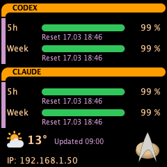
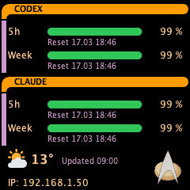
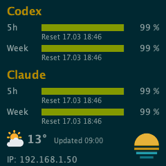
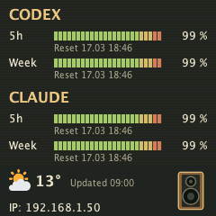
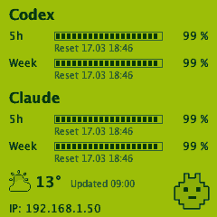

# Reference captures accompanying the implementation

These examples were generated from the implementation in the same commit, using the isolated comparison server,
240×240 (`vibedock-m1`), `source=reference`, `state=0`, fixed `mode=32`, `fallback=false`. No provider accounts or
real device data were used. The CSV contains original and fixed-32 results for all 45 bundled themes. Color counts
and changed-pixel percentages refer to the hardware RGB565 path. The original PNG column retains the rendered RGB
image; the reduced PNG visualizes decoded RGB565. Thus PNG differences can also show normal RGB565 conversion.
The zero `used`/`bits` fields in original-mode CSV rows mean unindexed RGB565, not a zero-color image.

Theme artwork retains its package's license/attribution. These are generated documentation previews, not new
independently licensed artwork. Reproduce with the same bundled artwork, fonts, time zone and renderer; platform
font differences can affect raster metrics. There is no claimed hardware download-time measurement here.

| Theme | Original render | Fixed 32-color hardware result |
| --- | --- | --- |
| Starship console / LCARS |  |  |
| Solarized |  |  |
| Hi-Fi |  |  |
| Handheld LCD |  |  |

| Theme | Actual colors | Index bits | Body bytes | Raw full bytes | Changed RGB565 pixels |
| --- | ---: | ---: | ---: | ---: | ---: |
| Starship console | 29 | 5 | 36,060 | 115,200 | 7.44% |
| Handheld LCD | 4 | 2 | 14,410 | 115,200 | 0.00% |
| Hi-Fi | 26 | 5 | 36,054 | 115,200 | 7.72% |
| Solarized | 27 | 5 | 36,056 | 115,200 | 6.53% |

[All 45 themes, original and fixed 32: machine-readable measurements](reference-240x240.csv).

The live page can additionally test automatic selection, other budgets/resolutions and current server data.
