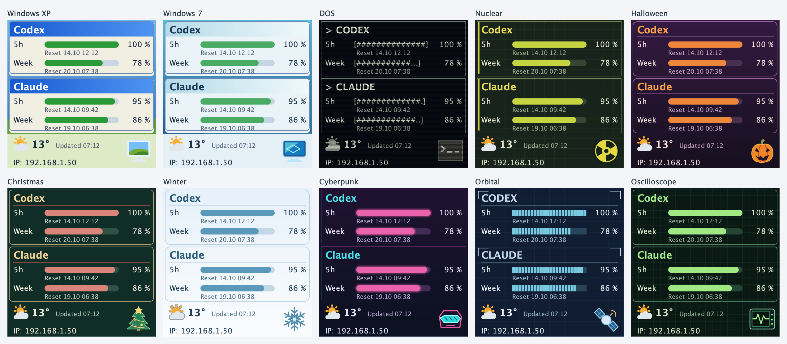

# Theme packages and editor: stacked delivery toward 0.4

Target: 0.4; assess 1.0 only after implementation and validation. Server-rendered images remain the device protocol;
theme packages do not require firmware changes. Each branch builds on the preceding branch; PRs initially target their
predecessor and are merged from the bottom upward. Keep each stage runnable and independently reviewable.

| Stage | Branch | Acceptance |
| --- | --- | --- |
| 1 | `feat/theme-package-format` | Bounded ZIP reader, manifest schema, self-contained fixture, integrity/reference validation and documentation. No runtime rendering change. |
| 2 | `refactor/theme-catalog` | Stable theme IDs replace enum coupling; existing settings and availability remain readable. Capture deterministic reference renders before changing any rendering. |
| 3 | `feat/declarative-theme-renderer` | All 35 existing themes represented in package data. Exact pixel equality against baseline renders on supported sizes, layouts and representative data states. Extend the language to preserve a theme; never simplify the theme to fit the language. |
| 4 | `feat/theme-icons` | Theme-specific default/catalog icons and emoticon/default/catalog selection. Existing designs keep their emoticons and no-icon choices. Check proposed icons inside each theme; Debugger uses a technical IDE bug silhouette, not a mascot face. |
| 5 | `feat/theme-import-export` | Authenticated import/export, full renderer/asset validation, atomic install and reload without restart. Same ID offers update or independent copy; incompatible packages leave working themes intact. Used/missing/deleted theme and icon references have explicit handling. |
| 6 | `feat/theme-editor` | Duplicate a theme, edit supported drawing properties/assets, preview all display sizes, save and export a self-contained package. Preserve recoverable built-in originals. |
| 7 | `feat/theme-collection-04` | XP, Windows 7, DOS, Nuclear, Halloween, Christmas, Winter, Cyberpunk, Orbital and Oscilloscope as packages with icons and previews; exercise the editor with real themes. |
| 8 | `docs/release-04-themes` | Manual, format examples, screenshots, release notes and 0.3.x upgrade validation, including saved designs, disabled themes and existing emoticons. |

## Non-negotiable compatibility

All existing themes remain **1:1 visually identical** after migration: colours, fonts, text, coordinates, bars, frames,
backgrounds, scaling and existing emoticon appearance/placement. Use fixed test data, clock, fonts and assets for
reference renders. Include narrow, square and tall panels, compact/split bands, changed orientation, unavailable/
partial/rate-limited readings and enlarged web displays. An explicitly selected new theme icon is a separate opt-in.

Theme drawing and instance layout remain separate: package data must not silently choose providers, device assignments
or band order. The existing settings files are not rewritten just by reading them. Version and back up any necessary
persisted migration before its first write. A missing theme must not silently replace a saved reference permanently.

The first end-to-end shareable-theme milestone is stage 5; the requested editor and new collection are complete only
after stage 7. Stage 1 alone is not advertised as user-installable themes. The envelope description and fixture live
in [`vibedock-server/themes/`](../../vibedock-server/themes/README.md).

## Catalog migration and rendering proof (stage 2)

`Scheme` is now an immutable definition with an explicit ID, rather than a Java enum. `ThemeCatalog` owns lookup,
ordering and wraparound; appearance families no longer depend on ordinal ranges. The built-in IDs, labels, order,
colours and drawing code remain unchanged. New in-memory catalogs can contain definitions outside the original 35;
runtime loading and installation remain later stages.

The design JSON still stores `scheme` as its original lowercase ID. Reading also accepts the former uppercase enum
names. Availability still uses `themes.json` with `disabled` as an array of IDs and `dark` as a boolean; reading does
not rewrite the file. Empty emoji choices and explicit emoji selections survive a design round trip. Unknown saved
IDs continue to be rejected at this stage; installed/missing package handling is part of stage 5.

`BaselineScheme`, `BaselineThemeArtwork` and `BaselineStatusImage` in the test sources freeze commit `85466a9` before
this migration. Only class names and Spring annotations were changed in these copies. They are independent of the
new catalog and of future drawing definitions. Do not regenerate them to make a rendering difference pass.

`ThemeRenderingCompatibilityTest` compares decoded full-colour PNG pixels and RGB565 wire pixels for all 35 themes:
eight panel sizes, six combinations of data/layout/icons/battery state, plus fractional and fitted-browser scales
(1,750 comparisons). This includes limited, incomplete and absent quota data, split and compact bands, a moved context
band and top alignment. Both sides use the same JVM, fonts and versioned Twemoji assets, avoiding platform-specific
golden-image differences. Existing orientation tests continue to cover device rotation separately.

Run the comparison from `vibedock-server/` using Java 21:

```sh
mvn -DargLine=-Djava.awt.headless=true -Dtest=ThemeRenderingCompatibilityTest,ThemeCatalogTest,ThemeSettingsTest test
```

This proof runs before and after structural changes. A successful comparison does not claim coverage of every possible
layout or future rendering operation; expand its cases when introducing new drawing capabilities in stage 3.

## Drawing packages (stage 3)

The original 35 built-in appearances now load from self-contained directories in
`vibedock-server/src/main/resources/themes/builtin/`. Their manifests, checksums and drawing definitions are validated
before use. Existing Java constants retain only the stable IDs; palette values and font choices come from the files.
The drawing language selects existing rendering recipes and adds bounded vector decorations; it does not replace
those proven algorithms with a general-purpose scripting language. See the [drawing-language reference](../../vibedock-server/themes/drawing.md).

The stage-2 frozen renderer is unchanged. Its same-runtime comparison remains the acceptance gate for all original
themes. Further tests pack/read each built-in theme and render it under a different ID, exercise the custom example,
check schema conformance and reject unsupported engines and unbounded drawing instructions. Theme import/export UI,
live catalog replacement, asset validation for imported graphics and theme-icon selection remain later stages.

## Theme icon selection (stage 4)

The editor now exposes Emoticon, Theme default and Theme catalog icon. `Design.icon` is optional; missing/null keeps
the original `mood` rendering and is omitted from saved JSON. Existing defaults and device overrides therefore keep
their exact appearance. Design copies, source renames and firmware layout adaptation retain a selected package icon.
Fixed references survive theme changes; missing references remain stored and use the saved emoticon as a visible
fallback. New missing selections are rejected. See the [package reference](../../vibedock-server/themes/README.md)
for the data shape, graphic subset and rollback snapshot.

Each built-in theme includes an original Apache-2.0 vector default and its previous CC-BY-4.0 illustration as a catalog
choice. The theme overview shows the new defaults as samples, without changing existing designs. The Debugger is a
faceless IDE-style bug with six legs and a breakpoint. `ThemeIconImageTest` renders all defaults inside their actual
themes on square and narrow panels into `target/theme-icons-*.png` for visual review. The frozen legacy pixel
comparison remains unchanged. Firmware and the device protocol still receive rendered pixels only.

## Live import/export (stage 5)

The Themes section now exports deterministic, compressed `.vibetheme` archives and inspects imports before offering
install, update or independent copy. Built-ins stay immutable. Theme definitions and all graphics are validated before
atomic persistence; a volatile immutable instance snapshot changes only after the file replacement succeeds. There
is no process-global installed catalog. Exact repeated imports are idempotent; other updates require a higher version.

The renderer resolves each persisted ID against one current snapshot, including icon assets, so a selected theme can
be updated without rewriting device designs or restarting. Missing IDs stay stored and temporarily render Midnight;
disabled IDs are retained, and a missing last-enabled package temporarily exposes Midnight without changing the file.
Used themes/fixed icons cannot be removed. Registry writes recheck new references while holding the same registry
lock used by removal. Browser catalog refreshes preserve an in-flight design draft.

Export compacts JSON and uses maximum ZIP/DEFLATE compression, retaining artwork and license bytes. The measured
bundled example is 11,611 bytes without authoring references and 15,188 with them. Optional `authoring/agent.txt` and
two minified schemas help a human-authorized agent develop the theme; they are inert, untrusted reference data and
never executed. Installation drops those generated references, and export regenerates current ones. The complete
format, endpoints, limits, data-directory layout and rollback are in the [package reference](../../vibedock-server/themes/README.md).

The visual editor is covered in stage 6 below. Custom theme selection uses configuration version 4 and the same pre-theme-feature
backup introduced in stage 4. Returning all designs to built-in themes with Emoticon restores the version-3 shape.


## Stage 6 — visual theme editor

The gallery opens protected built-ins as copies and installed themes as versioned edits (or independent copies).
A page-local draft carries editable metadata, the original drawing JSON and icon references/uploads. Typed color,
font, style and decoration controls preserve untouched definitions; no browser-side substitute renderer is used.
The normal sample renderer previews validated draft contents at supported panel sizes without installation.
The compact archive writer recomputes integrity and preserves inherited artwork/licenses; generated obsolete
upload files are pruned. Explicit save reuses the atomic installer. A canonical source digest is checked under
its lock to reject concurrent overwrites; preview/export do not poke devices or persist state. Leaving unsaved
work warns, validation errors retain the draft, and the gallery refreshes on focus without replacing a pending design.
Stage 6 introduces no firmware, dependency or format/schema change. It edits existing preset-based layouts with
bounded drawing layers; the next collection remains a separate stage.

## Theme collection (stage 7)

Ten new built-ins append to the original 35, in this order: Windows XP, Windows 7, DOS, Nuclear, Halloween,
Christmas, Winter, Cyberpunk, Orbital and Oscilloscope. The earlier IDs, order and rendered pixels stay unchanged;
swipe cycling now includes the enabled additions before wrapping to Midnight. Instance toggles work as before.

The collection uses existing presets and bounded decorative layers, without new renderer primitives, dependencies
or firmware. Each package contains one original, attributed Apache-2.0 SVG default icon, a drawing recipe and its
license. There is no inherited legacy icon. Theme default must still be explicitly selected on existing designs.
OS themes are visual homages with original desktop illustrations, not redistributed OS logos or wallpapers.

`ThemeCollectionTest` checks independent export/import rendering on every panel and three data states; it writes
five-column square/narrow review sheets. `ThemeRenderingCompatibilityTest` retains the frozen 35-theme pixel
comparisons, and `ThemesImageTest` regenerates the 45-theme README/manual overview.

Regenerate both overview images from `vibedock-server/` with Java 21 and Maven:

```sh
VIBEDOCK_THEMES_IMAGE=../docs/manual/themes.png mvn test -Dtest=ThemesImageTest,ThemeCollectionTest
cp target/theme-collection-vibedock-m1.png ../docs/manual/theme-collection.png
```

The matching narrow-panel review sheet is `target/theme-collection-135x240.png`.



## Explicit SVG color

The editor's safe vector upload route also accepts an optional literal RGB `color`. Uniform tinting keeps vector
geometry, holes, inherited currentColor alpha and opacity while applying the color to painted fills/strokes. The
original editing-session source is cached for reset; saved packages store the resulting SVG. Existing source assets
and theme defaults are unchanged without opt-in. The existing original-artwork endpoint supports both PNG and SVG
so saved vector icons can be recolored again. `SvgColorTest`, the HTTP export/reload test and the browser SVG test
cover this path together with the existing PNG-color behavior.

## Editor recovery and actual gallery

The compact five-column gallery is implemented in administration, including keyboard-accessible package menus and
visible edit shortcuts. The editor starts with design controls and a persistent preview. Sharing metadata and
low-level layer operations are collapsed. Discard restores the opened/saved draft snapshot even after invalid edits;
built-in appearance restoration replaces drawing only and stays unsaved until an explicit save.

Classic Mac, Classic Windows, Windows 11 and macOS now declare their common window paints in recipe version 2;
version-1 imports remain readable. The source files of these four packages therefore change, while all 1,750
original appearance comparisons remain the compatibility gate. Earlier byte-identical-file claims describe the
collection-only stage, before this window-data migration. Other non-window presets still use their style profiles
and advanced decorative layers. A fully freeform component/canvas authoring system remains outside this editor.
