# Disclaimer

**Use at your own risk.** VibeDock is free open-source software, provided "as is", without warranty of any kind,
express or implied, including fitness for a particular purpose. To the fullest extent permitted by applicable law,
the authors and contributors are not liable for any damage arising from installing, flashing, operating or being
unable to operate VibeDock, in particular:

- **Damage from flashing.** Writing firmware can make a device unusable ("bricked"), erase its original firmware and
  settings, or damage it, e.g. through a wrong board, an interrupted write, unsuitable cables, power supplies or
  adapters. Original firmware cannot be restored without your own full backup. Flashing voids any manufacturer
  warranty and is done entirely at your own risk. Of the ESP32 builds only the Waveshare ESP32-S3-Touch-LCD-1.47, ESP32-S3-Touch-LCD-1.54 and ESP32-C6-Touch-LCD-1.69 have been tested on hardware; the others are prepared and untested.
- **Security.** No software is free of errors. We cannot guarantee that VibeDock is free of security
  vulnerabilities. The server encrypts provider sign-ins and tokens in its data directory; keep that directory and its backups private. The
  administration uses plain HTTP unless you put HTTPS in front of it, and displays talk to the server over the
  network. Protecting the host, the network, the data directory and its backups is your responsibility.
- **Data and accounts.** Usage values may be wrong, delayed or missing. VibeDock reads interfaces of the providers
  that are not guaranteed public APIs; their use may change, stop working or be restricted by the providers' terms.
  Checking that your use complies with these terms, and with your employer's rules for work accounts, is your
  responsibility.
- **Third-party software and services** included in or used by VibeDock are subject to their own licenses and terms.

VibeDock is not affiliated with, endorsed or sponsored by Anthropic, OpenAI, xAI, Google, Cursor, Espressif or any
device manufacturer or seller, including Vibe TV (<https://vibetv.shop/>), which sells the display hardware with its
own firmware. This project is an independent, unofficial hobby project. Product names are trademarks of their owners. The full warranty disclaimer and limitation of
liability are in sections 7 and 8 of the Apache License 2.0 (see [License](#license)).

# About this manual

VibeDock shows how much of your AI coding plans is left (Claude, Codex, Grok, Gemini, Cursor and others) on small
desk displays. The **server** signs in to the providers, reads the usage, renders one image per display and
serves it; the **displays** fetch it over Wi-Fi when it can change, usually only the parts that changed. A display can be a VibeTV M1, another
supported ESP32 board, or any browser or program that loads a web page or a PNG (a *web display*).

This manual walks through every page of the administration and through installing the firmware on a display.
All screenshots come from a demo installation with made-up data and are generated by a script, so they can be
regenerated after every change (see [Regenerating this manual](#regenerating-this-manual)).

| Address | What |
| --- | --- |
| `http://<host>:10001/admin` | Administration (sign-in required) |
| `http://<host>:10002` | Image pull of the displays, web displays and the read-only usage API |

The administration user and password are set in `vibedock-server/.env` (`ADMIN_USER`, `ADMIN_PASSWORD`).

<!-- page break -->

## Getting a display

These displays are tested on hardware:

| Display | What it is | Bought at |
| --- | --- | --- |
| VibeTV M1 | 240×240 desk display, ESP8266 | Vibe TV, <https://vibetv.shop/> |
| Waveshare ESP32-S3-Touch-LCD-1.47 | ESP32-S3 1.47inch Touch Display Development Board (without pin header), 172×320, 262K colours, 2.4 GHz Wi-Fi and BLE 5, 240 MHz LX7 dual core | Waveshare shop at Amazon |
| Waveshare ESP32-C6-Touch-LCD-1.69 | ESP32-C6 1.69 inch Touch Display Dev Board, 240×280, 262K colours, 32-bit RISC-V, Wi-Fi 6, IEEE 802.15.4 (Zigbee 3.0, Thread) and Bluetooth 5 | Waveshare shop at Amazon |
| Waveshare ESP32-S3-Touch-LCD-1.54 | ESP32-S3 1.54 inch Touch Display Development Board, 240×240, 262K colours, 2.4 GHz Wi-Fi and BLE 5, 240 MHz LX7 dual core, 16 MB flash, speaker and battery connector | Waveshare shop at Amazon |

The VibeTV M1 comes with the seller's own firmware and app; this project replaces that firmware with its own (see
[Installing the firmware](#installing-the-firmware)), after you have saved a full backup of the original. On the
Waveshare boards VibeDock is installed over USB or from the browser. All other
boards in [Installing the firmware](#installing-the-firmware) are prepared, but not tested on hardware.

> **We have nothing to do with the seller.** This project is not made, endorsed or supported by Vibe TV, and we
> get nothing for this link. We built our own server and firmware for the device just for fun. Questions about
> the hardware, the original firmware, orders or warranty go to the seller; questions about this software go to
> this repository. Installing our firmware may void the seller's warranty and ends their firmware updates.

# Installing the server with Docker

The server runs as one Docker container. The image contains everything it needs: the server, the official sign-in
clients of the providers (Codex, Claude Code, Grok, Gemini CLI), the emoji, and the firmware of every supported
board with the browser flasher. Nothing has to be installed next to it.

## Requirements

- A computer that runs around the clock in the same network as the displays: a small Linux server, a NAS, a Raspberry
  Pi 4/5 (arm64) or a Mac/PC with Docker Desktop. The image exists for **amd64** and **arm64**.
- **Docker Engine with the Compose plugin 2.17 or later** (`docker compose version`), or Docker Desktop.
- Two free TCP ports: **10001** (administration) and **10002** (displays, web displays, usage API).
- For building from the sources: Git, access to the repository, and internet access during the build (Maven, npm;
  the emoji graphics are part of the repository). The first build takes several minutes.
- At run time the server needs internet access to the providers and to the weather service (Open-Meteo).

Choose one of these ways:

| Way | When |
| --- | --- |
| [Build from the sources](#build-from-the-sources-docker-compose) | Default; updates with `git pull` |
| [Ready-made image from the registry](#ready-made-image-from-the-registry) | No build on the target machine |
| [Image file](#image-file-for-a-machine-without-registry-access) | The target machine reaches no registry |
| [Synology NAS](#synology-nas) | Container Manager on a Synology |

## Build from the sources (Docker Compose)

```sh
git clone git@github.com:McFcologne/org.frifra.vibedock.git
cd org.frifra.vibedock/vibedock-server
cp .env.example .env
```

Open `.env` and set at least your own password:

```sh
ADMIN_PASSWORD=choose-a-long-password
```

Then build and start:

```sh
docker compose up -d --build
```

This uses `vibedock-server/compose.yaml` from the repository; there is nothing to edit in it, all settings come from
`.env`. For reference, the file in short:

```yaml
services:
  vibedock:
    container_name: vibedock-server
    build:
      context: .
      additional_contexts:
        git: ../.git              # the version comes from the Git tag
    restart: unless-stopped
    ports:
      - "${API_BIND_ADDRESS:-0.0.0.0}:10002:10002"         # displays and API
      - "${ADMIN_PUBLISH_ADDRESS:-0.0.0.0}:10001:10001"    # administration
    environment:
      ADMIN_USER: ${ADMIN_USER:-admin}
      ADMIN_PASSWORD: ${ADMIN_PASSWORD:?Set ADMIN_PASSWORD in .env}
      ADMIN_BIND_ADDRESS: "0.0.0.0"
      DATA_DIR: /data
      TIME_ZONE: ${TIME_ZONE:-Europe/Berlin}
      INTERNAL_URL: ${INTERNAL_URL:-}
      EXTERNAL_URL: ${EXTERNAL_URL:-}
    volumes:
      - type: bind
        source: ${VIBEDOCK_DATA_PATH:-./docker.data}
        target: /data
        bind:
          create_host_path: true
    security_opt:
      - no-new-privileges:true
    cap_drop:
      - ALL
```

The container is called `vibedock-server` and restarts by itself after a reboot (`restart: unless-stopped`). Check that
it runs:

```sh
docker compose ps              # STATUS "Up"
docker compose logs -f         # Ctrl+C ends the view only
```

Open `http://<host>:10001/admin` and sign in with `admin` and your password (see [Signing in](#signing-in)).

> Compose stops with *Set ADMIN_PASSWORD in .env* when the password is empty. The server never starts without a
> password.

## Settings in `.env`

| Variable | Default | Meaning |
| --- | --- | --- |
| `ADMIN_USER` | `admin` | User of the administration |
| `ADMIN_PASSWORD` | (required) | Password of the administration; a password set under [Settings](#administration-sign-in) replaces it |
| `ADMIN_PUBLISH_ADDRESS` | `0.0.0.0` | Host address of port 10001; `127.0.0.1` limits the administration to the host itself |
| `API_BIND_ADDRESS` | `0.0.0.0` | Host address of port 10002 (displays and API) |
| `TIME_ZONE` | `Europe/Berlin` | Time zone of reset times and the update time on the displays |
| `INTERNAL_URL` | host of the admin page, port 10002 | Address the displays use in the LAN, e.g. `http://192.168.1.10:10002` |
| `EXTERNAL_URL` | empty | Optional fallback address from outside, e.g. `https://vibedock.example.com` |
| `EXTERNAL_TLS_PROBE_URL` | empty | Optional LAN HTTPS listener used to inspect the external certificate; keeps the external hostname for verification (see [HTTPS pinning](#https-pinning-and-dns-fallback)) |
| `VIBEDOCK_DATA_PATH` | `./docker.data` | Host directory with all data (see below) |

`INTERNAL_URL` and `EXTERNAL_URL` can also be set later under [Settings](#settings); set the internal address
before pairing the first display, especially when you open the administration as `localhost`. After a change to
`.env` run `docker compose up -d` again.

Further variables for special cases: `LOG_DIR` (log directory, default `/data/logs`), `ACCESS_LOG=false` (no
request log), `POLLING_ENABLED=false` (no provider polling).

## Network and security

- The **administration (10001)** uses plain HTTP. Use a strong password and a trusted network, or set
  `ADMIN_PUBLISH_ADDRESS=127.0.0.1` and reach it through an SSH tunnel:

  ```sh
  ssh -L 10001:127.0.0.1:10001 your-server
  # then open http://127.0.0.1:10001/admin
  ```

- Flashing from the browser needs the administration on **HTTPS or `localhost`** (Web Serial). The SSH tunnel
  gives you `localhost`; alternatively put a reverse proxy with HTTPS in front of port 10001 (on a Synology:
  Web Station, see [Synology NAS](#synology-nas)). With HTTPS the password is encrypted as well.
- Only port **10002** may be reachable from outside, if at all, e.g. behind a reverse proxy with HTTPS as
  `EXTERNAL_URL`. Displays in the LAN use plain HTTP to the internal address.
- Displays outside the LAN use that HTTPS address. The VibeTV M1 speaks TLS 1.3 and TLS 1.2;
  the ESP32 boards only TLS 1.2 so far, so for them the reverse proxy must still allow TLS 1.2. An https connection
  takes the M1 a few seconds.
- The container runs as user **10001** without any Linux capabilities and with `no-new-privileges`.

## Data directory and backup

Everything the server keeps lives in the data directory, by default `vibedock-server/docker.data/` next to
`compose.yaml` (mounted as `/data` in the container):

| Path in `/data` | Content |
| --- | --- |
| `settings.json` | Data sources, manually entered tokens, network settings |
| `clients.json` | Displays, their pairing keys and designs, the default design |
| `auth/` | Sign-ins of the official clients, one folder per data source |
| `ota-signing.key` | Key that signs firmware updates; displays accept updates only signed with it |
| `firmware/` | Own firmware builds uploaded under **Devices → Firmware**, one folder per board (only when used) |
| `logs/` | `vibedock.log` and the daily request logs (kept 14 days) |

The directory contains **encrypted credentials and the private `.installation-id` needed to read them**: keep it private, never commit or publish it. Settings and sign-in caches remain readable JSON; only credential fields such as tokens, refresh tokens and API keys are encrypted. The portal password remains a BCrypt hash, without additional encryption. Include hidden files in a backup; existing plaintext credentials and the earlier whole-file encryption format are migrated automatically on startup. Password-protected data-source exports remain independent of that installation identity. It survives
restarts, rebuilds and updates of the image.

To keep the data elsewhere, prepare a directory for user 10001 and name it in `.env`:

```sh
sudo mkdir -p /srv/vibedock
sudo chown 10001:10001 /srv/vibedock
sudo chmod 700 /srv/vibedock
echo 'VIBEDOCK_DATA_PATH=/srv/vibedock' >> .env
docker compose -f compose.yaml -f compose.host-path.yaml up -d
```

**Backup:** stop the container briefly and copy the whole directory, then start it again:

```sh
docker compose stop
sudo tar -czf vibedock-backup-$(date +%F).tar.gz -C docker.data .
docker compose start
```

Restore by unpacking into an empty data directory before the start. The backup contains credentials: store it as
carefully as the directory itself. The data sources alone can also be saved password-protected with
[Export](#export-and-import).

## Updating

```sh
cd org.frifra.vibedock/vibedock-server
git pull
docker compose up -d --build
```

`.env` and the data directory stay as they are. The new image brings the new firmware too: afterwards the displays
show **Update to …** on the overview, the device cards and the firmware page (see [Updates over
Wi-Fi](#updates-over-wi-fi)).

## Ready-made image from the registry

Every release is also published to Docker Hub and the GitHub Container Registry, for amd64 and arm64; Docker picks
the right one:

```sh
docker pull mcfcologne/vibedock-server:latest             # Docker Hub; or a version: ...:0.1.0
docker pull ghcr.io/mcfcologne/vibedock-server:latest     # the same image from GitHub
```

Use one of them as the image in the `docker run` command or the `compose.yaml` below instead of
`vibedock-server:amd64`; to update, pull again and recreate the container. On a Synology, *Container Manager ›
Registry* finds `mcfcologne/vibedock-server` on Docker Hub, and *Image* then shows when a new version is available.

## Image file for a machine without registry access

Pull the image from the registry where possible (above). For a machine that cannot reach a registry, make an image
file elsewhere: `scripts/image.sh amd64` (or `arm64`) builds it from the sources as
`target/vibedock-server-<version>-amd64.tar`, or a machine with registry access saves the published one with
`docker pull --platform linux/amd64 mcfcologne/vibedock-server:0.3.1` and
`docker save mcfcologne/vibedock-server:0.3.1 -o vibedock-server-0.3.1-amd64.tar`. GitHub releases no longer carry
the image (up to 0.3.0 they did, as `vibedock-server-<version>-<arch>.tar.gz`). Load the file for your platform:

```sh
# loads the image vibedock-server:amd64 (the version is in the file name and in the administration)
docker load -i vibedock-server-0.3.1-amd64.tar
```

An image saved from the registry keeps its name (`mcfcologne/vibedock-server:0.3.1`): use that name instead of
`vibedock-server:amd64` below.

Prepare the data directory and an environment file with the password (`chmod 600`, so it stays private), then start:

```sh
sudo mkdir -p /srv/vibedock
sudo chown 10001:10001 /srv/vibedock
sudo chmod 700 /srv/vibedock
printf 'ADMIN_PASSWORD=choose-a-long-password\n' > vibedock.env
printf 'TIME_ZONE=Europe/Berlin\n' >> vibedock.env
chmod 600 vibedock.env

docker run -d --name vibedock-server --restart unless-stopped \
  -p 10001:10001 -p 10002:10002 \
  --env-file vibedock.env -v /srv/vibedock:/data \
  --security-opt no-new-privileges:true --cap-drop ALL \
  vibedock-server:amd64
```

To update, load the new file, remove the container and start it again with the same command; the data stays in
`/srv/vibedock`:

```sh
docker load -i vibedock-server-0.3.1-amd64.tar
docker rm -f vibedock-server
docker run -d --name vibedock-server ...   # same command as above
```

### With Docker Compose instead of `docker run`

For the loaded image, a folder with two files is enough, e.g. `/opt/vibedock/`. `compose.yaml`:

```yaml
services:
  vibedock:
    image: vibedock-server:amd64        # vibedock-server:arm64 on ARM
    container_name: vibedock-server
    restart: unless-stopped
    ports:
      - "10002:10002"                 # displays, web displays, usage API
      - "10001:10001"                 # administration; "127.0.0.1:10001:10001"
                                      # limits it to this host
    environment:
      ADMIN_USER: ${ADMIN_USER:-admin}
      ADMIN_PASSWORD: ${ADMIN_PASSWORD:?Set ADMIN_PASSWORD in .env}
      TIME_ZONE: ${TIME_ZONE:-Europe/Berlin}
      INTERNAL_URL: ${INTERNAL_URL:-}   # e.g. http://192.168.1.10:10002
      EXTERNAL_URL: ${EXTERNAL_URL:-}   # e.g. https://vibedock.example.com
    volumes:
      - /srv/vibedock:/data             # owned by UID 10001, mode 700
    security_opt:
      - no-new-privileges:true
    cap_drop:
      - ALL
```

`.env` next to it (`chmod 600`):

```sh
ADMIN_PASSWORD=choose-a-long-password
TIME_ZONE=Europe/Berlin
INTERNAL_URL=http://192.168.1.10:10002
```

Start, and update after loading a new image file:

```sh
cd /opt/vibedock
docker compose up -d                 # start
docker load -i vibedock-server-0.3.1-amd64.tar
docker compose up -d --force-recreate   # update: same data, new image
```

## Synology NAS

1. Get the image: in **Container Manager › Registry** search `mcfcologne/vibedock-server` and download it (then set it
   as `image:` in `compose.synology.yaml`), or import an image file from
   [Image file for a machine without registry access](#image-file-for-a-machine-without-registry-access) under
   **Container Manager › Image › Import**.
2. Create the folder `/volume1/docker/vibedock-server/data` and give the container user (UID 10001) write access.
3. Create a project in **Container Manager › Project** in `/volume1/docker/vibedock-server` with the file
   `compose.synology.yaml` from the repository. Write the password into the project (Container Manager does not
   always read a `.env`), never into Git.
4. On the Synology the administration listens on **8080** and the device port on **8081**. Displays in the LAN use
   `http://<NAS-IP>:8081` as internal address.
5. Publish the administration with HTTPS through **Web Station** (or the reverse proxy under **Control Panel ›
   Login Portal › Advanced › Reverse Proxy**): from `https://<NAS name>:10001` to `http://localhost:8080`, with
   the NAS certificate. The administration is then
   encrypted, and **flashing from the browser works directly** on `https://<NAS name>:10001/admin`, without an SSH
   tunnel. The device port 8081 can be published the same way as `https://…:10002` for `EXTERNAL_URL`.

### TLS pin lookup from a Synology container

An HTTPS address can work from a display on a phone hotspot while certificate inspection from the server
container times out. These are different network paths: external reachability does not establish that the
container can reach the public address through NAT loopback or the proxy through its LAN address.

If the reverse proxy runs on a separate host, the automatic internal-host fallback reaches the VibeDock backend,
not that proxy. Add the proxy's actual LAN HTTPS listener to the project's Compose `environment`, for example:

```yaml
environment:
  EXTERNAL_TLS_PROBE_URL: "https://192.168.1.20:10002"
```

Use your proxy's LAN IP and internal HTTPS port, which may differ from the router's public port. Do not use the
plain HTTP backend. The server still verifies the certificate against the configured external hostname and sends
that hostname as SNI. Recreate the container to apply the environment change; restarting an existing container is
not enough. See [HTTPS pinning and DNS fallback](#https-pinning-and-dns-fallback).

If **Check pin again** still reports `Connect timed out` for the correct proxy IP, compare access from the NAS host
and from the container. A successful TLS handshake followed by HTTP 404 for `/` is sufficient to establish TLS
reachability; a timeout occurs before certificate validation. `wrong version number` or `Unsupported or unrecognized
SSL message` can indicate a plain HTTP listener instead of HTTPS.

The DSM firewall can filter forwarded Docker traffic before Docker's own allow rules. In the confirmed case,
`FORWARD` entered `FORWARD_FIREWALL` before `DEFAULT_FORWARD`; an unconditional `DROP` rejected the container's
connection to TCP 10002 before it reached Docker's allow rule. TCP 443 and DNS were allowed, so ordinary Internet
access and public DNS still worked. A working host connection alone does not rule out this firewall restriction.

For this case, allow the Docker source subnet and the proxy's HTTPS destination port in DSM:

1. Find the current Docker subnet; do not assume that every installation uses the example below:
   `sudo docker network inspect vibedock-server_default --format '{{json .IPAM.Config}}'`.
   Use the actual network name if the Compose project has a different name.
2. Open **Control Panel → Security → Firewall → active firewall profile → Edit Rules → Create** on the NAS
   running the VibeDock container. Select **All interfaces** in the rule editor so the Docker bridge is covered.
3. Under **Ports**, choose **Custom**, then **TCP**, **Destination port**, and the proxy's HTTPS port (e.g. `10002`).
4. Under **Source IP**, choose **Specific IP → Select → Subnet**. For a Docker network `172.30.0.0/16`, enter
   `172.30.0.0` and mask `255.255.0.0`. This covers changing container IPs in that network; it also permits the
   other containers in that subnet to use the selected port.
5. Select **Allow**, leave the rule enabled, and place it **above the matching deny rule**. Save and apply the
   profile, then use **Check pin again**. Keep the firewall enabled.

A recreated Docker network may get a different subnet. Recheck this rule after recreating the network, or configure
an explicit non-overlapping subnet with Compose IPAM if a stable subnet is required. A known pin is sent to the
display during pairing; re-pair an existing display to transfer it (USB **Only pair** keeps the installed firmware).

## Troubleshooting

| Symptom | Cause and remedy |
| --- | --- |
| `Set ADMIN_PASSWORD in .env` | Password missing in `.env` |
| Container keeps restarting with *Permission denied*, or the administration says *Saving is not possible* | Data directory not writable for UID 10001: `sudo chown -R 10001:10001 <directory>` |
| `port is already allocated` | Port 10001 or 10002 in use; free it or change the host side in `compose.yaml` (`"10011:10001"`) |
| Displays show *Server unreachable* | Internal address wrong or port 10002 blocked by a firewall; check [Settings](#settings) |
| Browser flasher says it needs Chrome or Edge | Administration not opened over HTTPS or `localhost`; use HTTPS (reverse proxy, Web Station) or the SSH tunnel |
| Data source stays *unavailable* | Sign in again under **Data sources › Manage**; details in `docker compose logs` |

Logs: `docker compose logs --tail 200` for the console, `/data/logs/vibedock.log` for pairings, device pulls and
provider errors. **Devices → Troubleshooting → Server log** also shows recent application-log entries, with manual
refresh and a text view; it includes TLS/DNS probe diagnostics. Neither log contains keys, tokens or passwords.

**Removing** the server: `docker compose down` stops and removes the container; the data directory stays until you
delete it yourself.

# Signing in

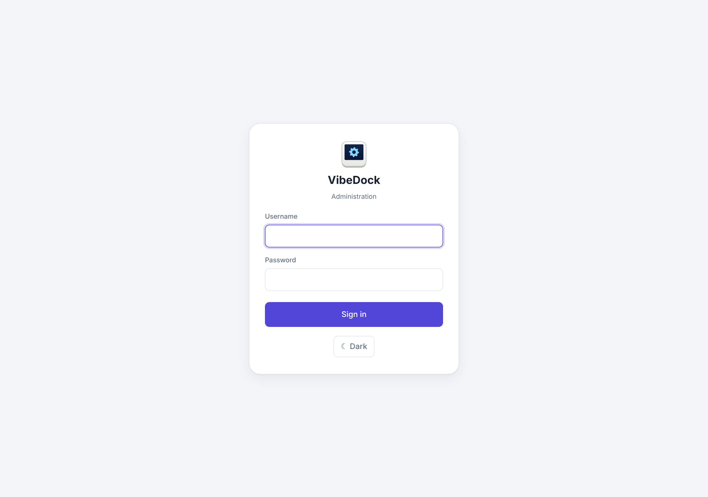

Open `http://<host>:10001/admin` and sign in with the administration user. The session ends with **Sign out**
at the top right. **Stay signed in** is enabled by default: this browser stays signed in for 30 days, renewed during use, including across browser and server restarts. Turn it off for a session that expires after 15 minutes of inactivity. Signing out revokes this browser's saved login; changing or resetting the administration password signs out all browsers. Clearing browser cookies also requires a new sign-in. **Dark** switches between light and dark appearance. Once signed in, the choice is saved for the whole
server instance and sent to capable devices: directly over their existing LAN callback, with the next authenticated
image response as a fallback. Their setup/status web pages follow it live (up to five seconds while open). The
preview reloads only after a new complete device image; hidden tabs pause polling. This appearance is separate
from the theme of the display image. The switch on the sign-in page changes only that open page.
The footer of every page links the README, this manual as PDF (**Manual (PDF)**) and the licenses.

# Overview


The overview shows everything at a glance and refreshes itself while the tab is open:

- **Data sources** lists every provider account with its sign-in state and the usage left, e.g. *5h 36 % · Week
  63 % left*. The badge on the right shows the state of the data: **Current**, **Paused** (the source is not
  polled; displays show it as paused) or **unavailable** (the provider gave no usable answer, e.g. expired
  credentials).
- **Default display** shows the image of the default design as a VibeDock shows it, with its theme. **Edit design**
  opens the display editor.
- **Devices** lists all displays with their IP address and connection state. A display with older firmware shows
  **Update to …**; a click starts the update over Wi-Fi.

**Refresh** fetches all sources at once instead of waiting for the next poll.


# Devices


Every paired display has a card:

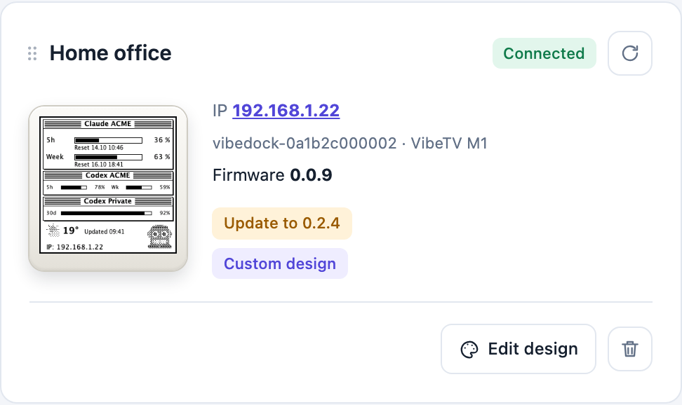

- **Name** with the **grip** (six dots) on the left: drag a card to another place to change the order, or focus the grip
  and use the arrow keys. The order is used on all pages.
- **State**: **Connected** while the display fetches its image, otherwise *Not connected* with the time of the
  last contact.
- The **reload** button makes the display redraw immediately with its next pull.
- **Preview**: the current image of this display. A click enlarges it.
- **IP**, **identifier** and **board** (e.g. *vibedock-0a1b2c000002 · VibeTV M1*).
- **Network** below the IP: the Wi-Fi the display is in (current firmware) and its signal, in the warning colour
  below −75 dBm, and how its last pull reached the server: **LAN** over the internal address, **external** over the
  external one (the tooltip names the address). A display at home that shows *external* takes the detour over the
  public address; a restart brings it back to the LAN.
- **Firmware**: *Latest version installed*, or **Update to …** to install the server's firmware over Wi-Fi. While
  the update runs the card shows *Updating*; the state disappears on every page when the display reports the new
  version.
- **Default design** or **Custom design**: whether the display follows the default or has its own design.
- **Edit design** opens the editor for this display; the **bin** removes the display (it forgets its pairing on
  its next pull).

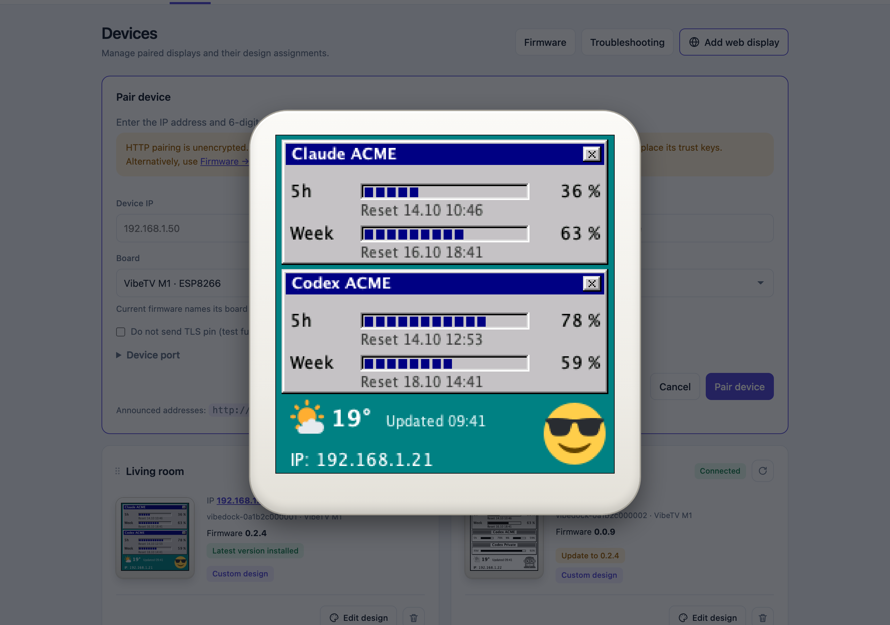

## Pairing a display with its code

**HTTP pairing is unencrypted.** Use it only on a trusted home network. A network attacker can read the
device key or replace its TLS/OTA trust keys. The form shows a warning and remains available without
extra activation. Alternatively, pair over USB without reinstalling firmware: **USB** in the same dialog.

**Pair device** has two ways, switched at its top right: **Wi-Fi** with the display's IP address and code, and
**USB** for a display connected to this computer. The dialog opens with the way chosen last in this browser. **USB** is
the same pairing as **Only pair** on the firmware page (one form in two places, see [Installing the firmware from the
browser](#from-the-browser-recommended)): **Pair now**, choose the display, enter a **Name**, choose the
**Wi-Fi** and its password, **Send to the display**. It needs Chrome or Edge with the administration opened over https
or on `localhost`; the page reloads once the display shows its image.

A display without pairing shows its IP address and a six-digit code (see [The display's own
screens](#the-displays-own-screens)). Open **Pair device**, enter both, optionally a name, and choose the
**board** for a display whose firmware does not report its board (VibeDock firmware reports it itself):

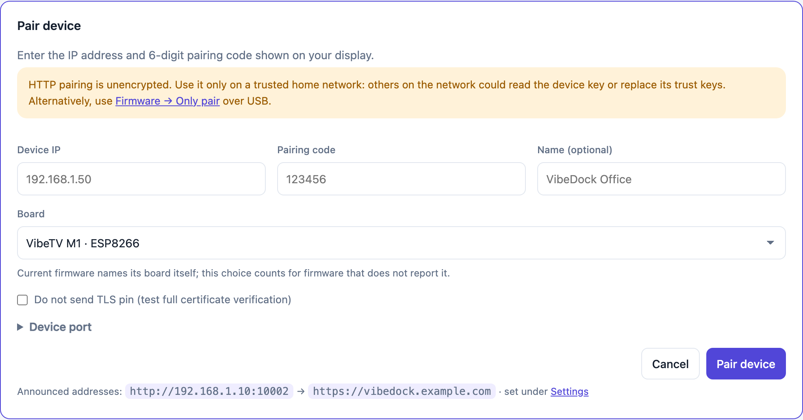

The display supplies its subnet mask automatically. IP changes within that network are accepted for immediate
reloads; older devices without a mask use the first three blocks of the original IPv4 pairing IP (`/24`).
There is no extra input field. Version 0.1.0 remains supported with `/24`; the first valid authenticated
mask report from a newer client may replace this fallback once. The original IP stays fixed, and later
firmware updates or IP reports cannot change an already learned network.

The server sends its addresses (internal first, external as fallback) to the display; the display then shows its
image. **Device port** is only needed when the display does not listen on port 80. Displays installed from the
browser are paired over the USB cable instead (see [Installing the firmware](#installing-the-firmware)).

### HTTPS pinning and DNS fallback

The server checks the HTTPS certificate and sends its root certificate and, when available, its fingerprint
(**TLS pin**) during pairing. The M1 can use this pin for its first HTTPS connection. Without a pin, it checks the
certificate fully against the supplied root and learns its own pin. ESP32 boards currently always use the full
check. After a certificate renewal the M1 does another full check; a root change requires pairing again.

**Settings → Network** shows whether the server knows a pin and displays its fingerprint; the pairing forms only offer **Do not send TLS pin**.
The route and target IP/port are shown explicitly, including **Public DNS fallback** and a **cached** marker when
an earlier check is reused. **Certificate details** shows subject, issuer, validity dates, TLS version and SHA-256.
**Check pin again** repeats the status query; successful checks are cached for one minute. The refresh button has
a refresh icon; the line below shows the last refresh time, result and request duration, including failures. To test the M1 without
a server-supplied pin, enable **Do not send TLS pin** when pairing over the network or USB. The root certificate
is still sent. Re-pairing replaces the previous pin; **Only pair** over USB keeps the installed firmware.

Without a probe override, the server tries these routes to inspect the external certificate:

1. The external hostname with the server's usual DNS resolver.
2. The configured internal host on the external HTTPS port, using the external hostname for TLS.
3. Public DNS answers from **8.8.8.8** and **1.1.1.1**, connecting directly to the returned IPs.
4. If no route is reachable, the public certificate log (`crt.sh`) may supply a root only. The display then needs its own full check before learning a pin.

A local DNS rewrite can send the public hostname to a plain HTTP service. The public-DNS alternative avoids that
rewrite while preserving the original external hostname for SNI and certificate verification. The server still
rejects untrusted certificates and wrong hostnames. It changes neither system DNS nor device DNS; the HTTPS port
must still be reachable, and public DNS cannot bypass missing NAT loopback or firewall rules.

If the reverse proxy uses a different LAN address or port, set `EXTERNAL_TLS_PROBE_URL`, for example
`https://192.168.1.10:10002`, in the container environment (or `.env` with the supplied Compose file). This explicit
route takes precedence. Use the proxy's **HTTPS listener**, not the plain HTTP backend. Recreate the container after
changing its environment, or restart a local Spring Boot instance.

To diagnose a missing pin, open **Devices → Troubleshooting → Server log**, trigger **Check pin again**, then refresh
the log. `Public DNS … resolved …` records the public answers; `TLS certificate for … verified through public DNS
address …` confirms verification. `Unsupported or unrecognized SSL message` usually means the selected port
answered with plain HTTP instead of TLS. The view shows up to 500 lines from the last 256 KiB, with refresh and a
text view. It opens at the latest entry and updates every five seconds while expanded and visible. Scroll up to
read older entries without being moved to the end; scroll back to the bottom to follow new entries again.
**Live updates** can be switched off.

## Web displays

A web display is any browser, tablet or program that shows the VibeDock image by itself, e.g. a wall tablet or a
digital photo frame. **Add web display** creates it:

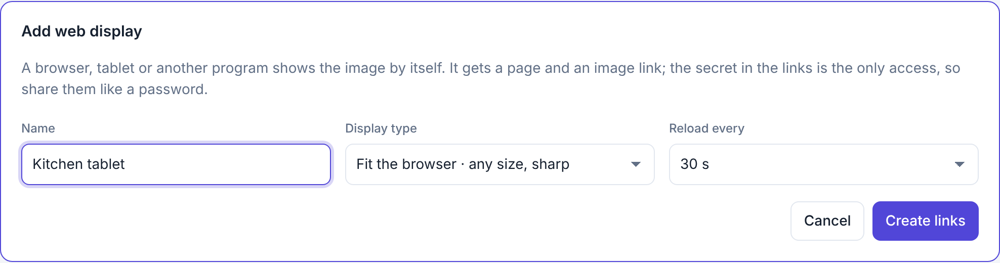

- **Name**, **Display type** and **Reload every** (how often the page loads a new image). *Fit the browser* (the
  default) gives the image the shape of the browser window, e.g. a phone held upright or a TV; the other types keep
  the size of a device display (e.g. *320×240 landscape*), shown as large as the window holds.
- The page asks for the image in its window's size and the screen's pixel ratio, so it is sharp on high-resolution
  screens (phones, tablets, 4K). Large screens get a zoomed layout with readable text. The PNG link without
  parameters has the type's own pixels (*Fit the browser*: 360×640); programs can add `?w=<width>&h=<height>&r=<ratio>`.
- **Home screen:** on an iPhone or iPad, *Share › Add to Home Screen* gives the page the display icon and the
  display's name; it then opens full screen, keeping the notch and the home indicator free.
- The page asks every 3 seconds whether its image changed, so a new design, new usage data or the next photo appear
  within seconds; the reload interval stays as a fallback.
- **Background and status bar:** before the first image loads, the page explicitly sets the selected theme’s
  background colour. After every successful image load, it samples the top edge and updates the page background
  and browser theme colour, including timed reloads, theme swipes and photo changes. The iPhone home-screen
  status bar is translucent so the background shows through. If an image cannot be loaded, the last colour stays.
- **Double tap** (or double click, or the space bar) starts or stops the slideshow, like on touch displays.
- **Swipe** left or right on the page (or press ← →) to change the theme, in a slideshow the photo, like on touch
  displays; the web display then keeps it as its own design.
- The card then offers two links, both containing a long secret: the **Page** for browsers (full screen, reloads
  itself) and the **PNG** for programs. Copy them with the copy button or open them with the arrow.
- **External address** switches both links between the internal and the external server address (see
  [Settings](#settings)).
- **New links** creates a new secret; the old links stop working at once. Treat the links like a password.

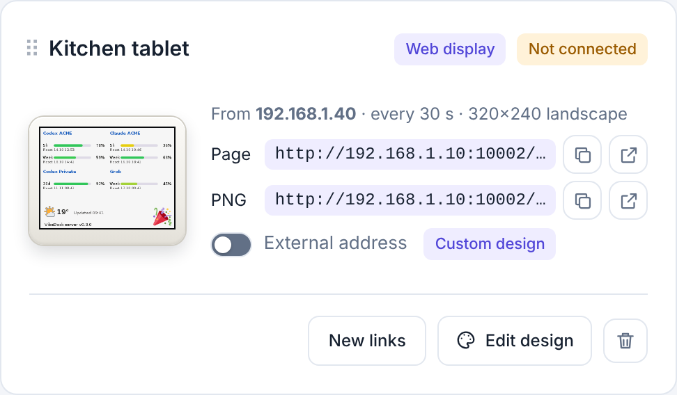

The page as a browser shows it, here with the *Paper* theme on a 320×240 type; the footer names the server version
instead of an IP address:

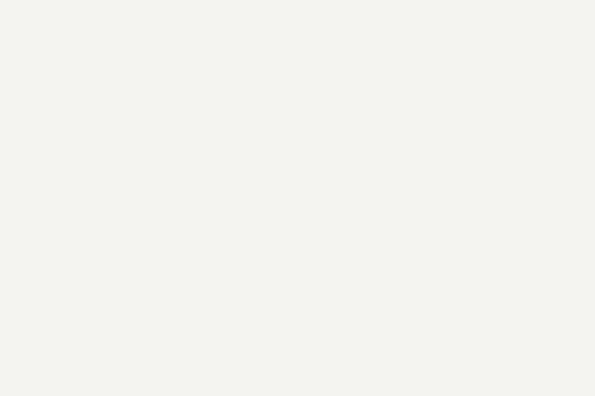

The page loads the image in the size of the screen. When a phone or tablet turns or the window changes its size, the
last image fills the new area stretched and blurred for the moment until the image in the new size has loaded.

A web display is *Not connected* until the page or PNG was loaded for the first time. Web displays have no firmware
and do not appear on the firmware page.

# Display design

The display editor sets what a display shows. **Design for** chooses the default design or a device. The preview
on the right is rendered by the server exactly as the display will show it. Every change is saved right away.


<!-- page break -->

## Themes

**Appearance → Browse all themes** jumps to the gallery below the editor. It shows the forty-five built-in themes and installed themes in five
columns on a desktop, with identical example data rendered by the same code as the displays. The active card has a compact selection marker. The pencil opens **Customize** / **Edit theme**; the **⋯** menu contains Export, package version and installed-theme copy/remove actions. Menus close with Escape.

**Use theme** applies
the theme to the design selected under **Design for**, and saves it right away. For an inherited device design,
enable **Custom design** first, or change the default design instead.

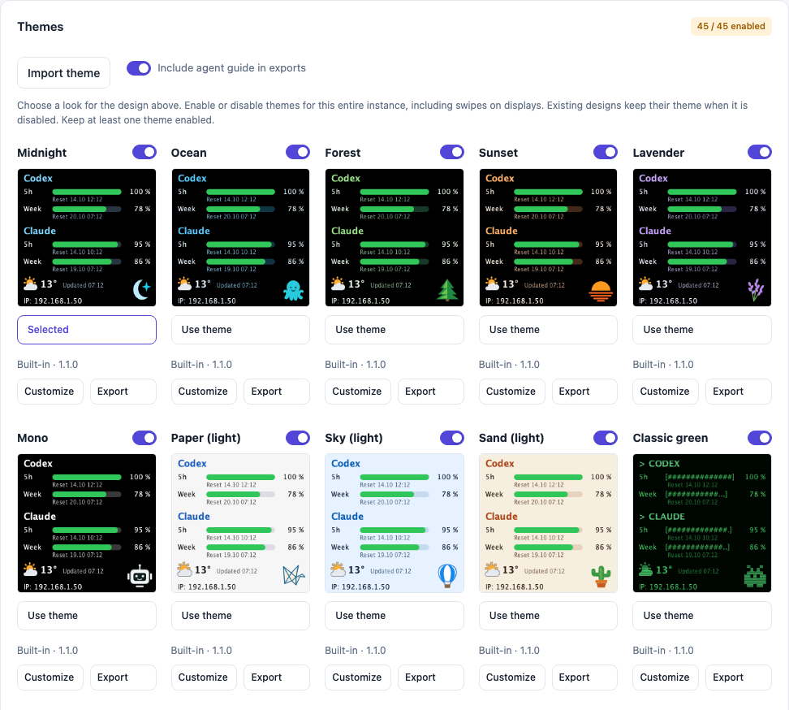

**The toggle beside each theme name** controls which themes this installation offers. Switching it off removes a theme from
new selections and skips it when swiping through themes on a display or web display. Existing default and device
designs keep the theme they already use, and their other settings can still be edited. Enable the theme again to
make it selectable. At least one theme must stay enabled. These choices are stored in `themes.json` in the data
directory and survive server updates and restarts; include the file in data-directory backups.

The additional looks are **Mission Control**, **Departure Board**, **Nordic**, **Hi-Fi**, **Solarized**, **Pixel Quest**,
**Bauhaus**, **E-Ink**, **Industrial**, **Porcelain**, **GitHub Dark**, **VS Code**, **Terminal**, **Git Diff** and **Debugger**. All support full-width, half-width and compact usage bands,
both weather/mood positions and the available display sizes. Numeric quotas keep their meaning; the new themes
use their own bar colours, with a warning colour below 20% remaining (E-Ink stays monochrome). No firmware update
is needed.

<!-- page break -->

## Bands

A design is a list of **bands** from top to bottom. A usage band holds:

- **1 × full width**: one data source with bars, percentages and reset times,
- **2 × half width**: two data sources side by side,
- **1 × compact row**: one data source in half the height, without reset times.

The default design above uses two full-width bands, one per source (*Claude ACME*, *Codex ACME*); the
[web display](#display-types-and-hidden-bands) further below shows two half-width sources per band.

Up to five usage bands fit a tall screen (e.g. a phone as a web display); smaller displays show the first ones that
fit. **On tall screens** chooses where spare height goes: *Spread the bands evenly* (the default) or *Bands at the
top*, where the bands stay together and a weather and mood band at the end keeps to the bottom edge.

The **Weather & mood** band holds the weather (icon and temperature for the **Weather location**) and the selected
**Icon**; **Swap weather & mood** exchanges the two slots. The update time and the IP address move with this band.

Change the order with the grip (drag) or with ↑ and ↓, remove a band with ×, add one with **+ Add usage band**. A
data source that is paused or unavailable is shown as such on the display.

<!-- page break -->

## A device's own design

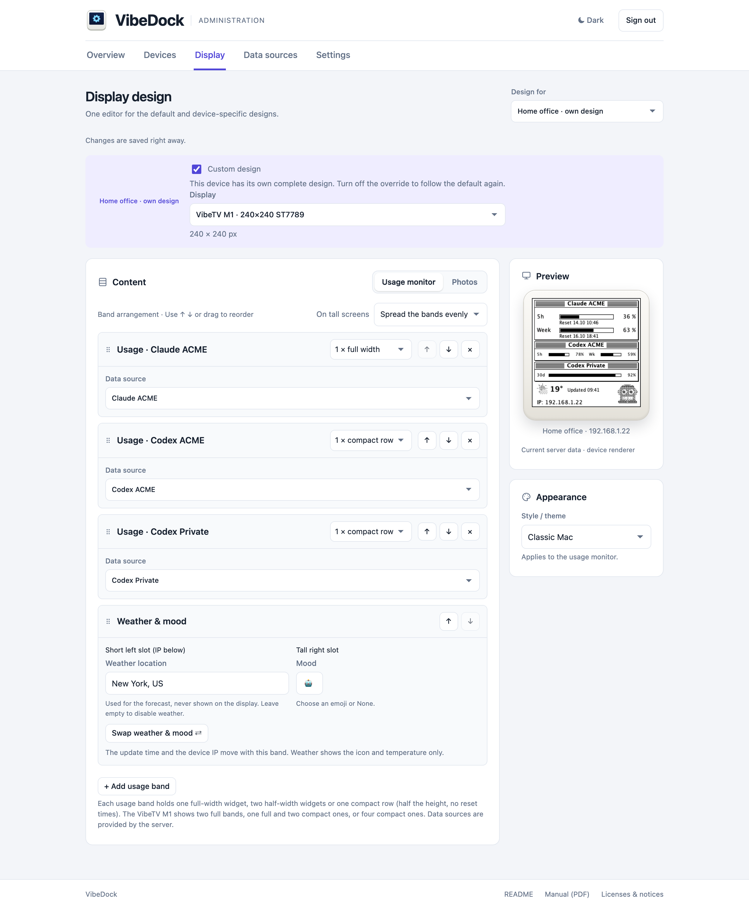

With **Custom design** a display gets its own complete design; turn it off to follow the default again (every
change is saved right away). Here the display *Home office* shows one full band and two compact rows in the
*Classic Mac* theme.

<!-- page break -->

## Photos and slideshows

The switch **Usage monitor | Photos** at the top of the *Content* box chooses what the display shows. **Photos** shows
photos instead of the usage monitor:

- **Add photos** uploads JPEG, PNG, GIF or BMP files (not HEIC). The server keeps only a copy reduced to 600 × 600
  pixels at most, turned upright like the photo app shows it; the original is not stored. All designs share these
  photos; **✕** and **Delete** on a photo removes it from every design.
- Click the photos to show, in the order clicked (the number on each); click again to leave one out.
- **Each photo** sets how long one stays (10 seconds to an hour), **Shuffle** a new order every round. Displays with
  the same slideshow change together; the display pulls once per photo then.
- **Only at certain times** shows the photos only in that time of day (e.g. 22:00 to 07:00) and the usage monitor
  at other times; the times are those of the server (Docker: `TIME_ZONE`). The switch then shows a green dot, and the
  bands of the usage monitor for the other times appear below the photo settings.
- Switching back to **Usage monitor** keeps the photo selection and its settings for later.
- On a touch display a swipe left or right shows the next or previous photo; a double tap stops the slideshow or
  starts it outside its times (also on a web display page: double tap, double click or the space bar).

The server cuts every photo to the display's shape from its middle, so a portrait photo fills a narrow display.

## Display types and hidden bands

How many bands fit depends on the **Display** type. The VibeTV M1 (240×240) shows two full bands, one full and two
compact ones, or four compact ones. Bands that no longer fit are marked below a dashed line *… ends here · usage
bands below are not shown*; **Make all bands compact** fixes it with one click:

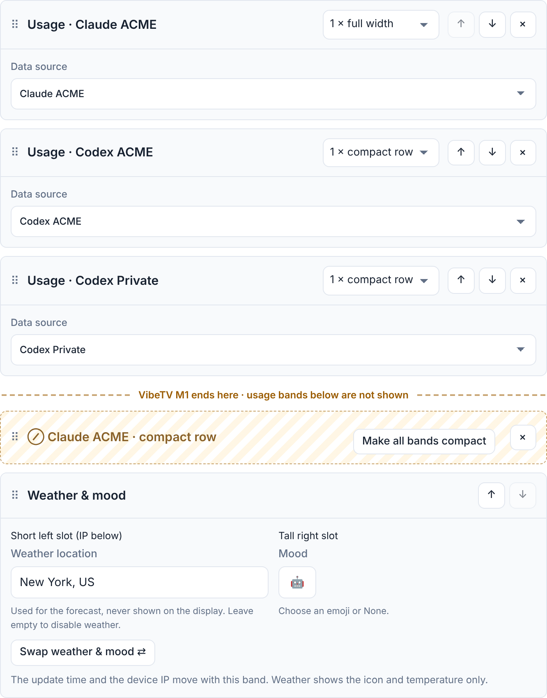

Displays with other sizes, here a web display with 320×240 landscape, keep the same editor; the preview follows
the aspect ratio:

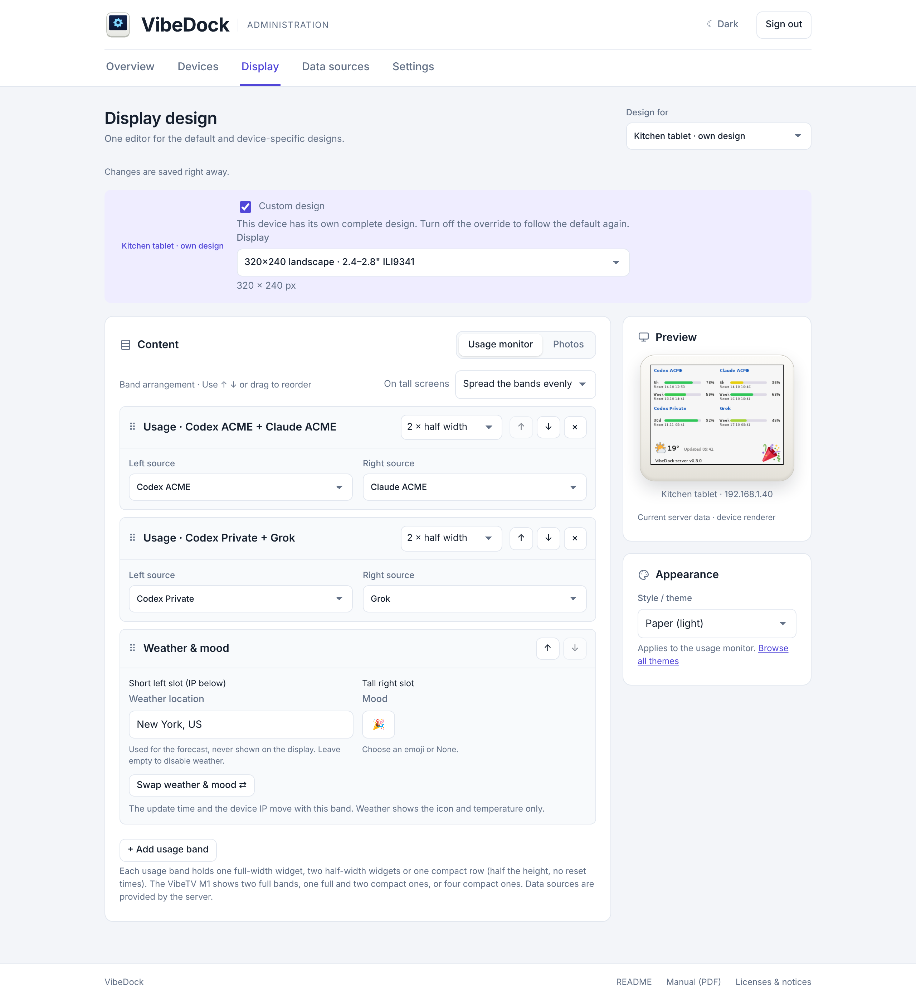

## Appearance and mood

**Style / theme** sets colours and look of the usage monitor; the forty-five themes:

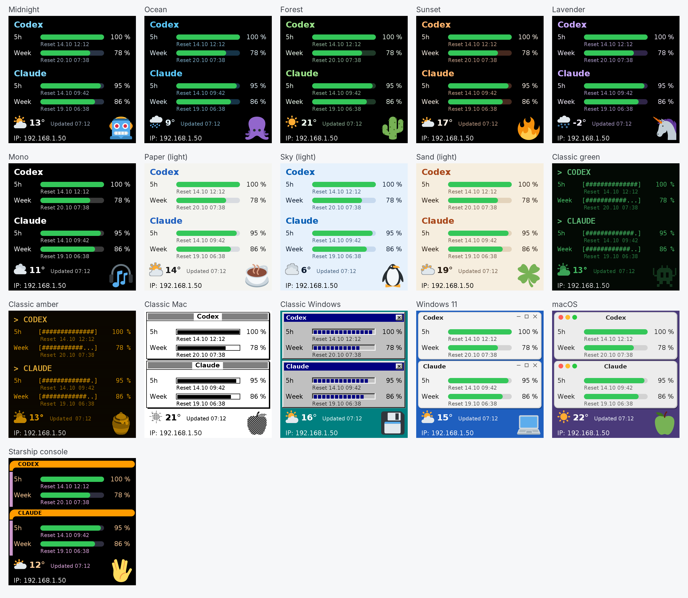

The 0.4 collection adds **Windows XP, Windows 7, DOS, Nuclear, Halloween, Christmas, Winter, Cyberpunk, Orbital**
and **Oscilloscope**, each with its own optional default icon. They are ordinary declarative packages: customize,
export and share them through the same editor. Existing themes and Emoticon/None selections stay unchanged.

**Icon** chooses between **Emoticon**, **Theme default** and **Theme catalog icon**. Existing designs stay on
Emoticon, including a previous None choice. In that mode the mood button opens the emoji picker with quick picks,
search and all emoji; *None* leaves the slot empty. Theme default follows the selected theme, including swipes.
Theme catalog icon fixes an icon from any theme and keeps it when the theme changes. The theme overview previews
the new defaults; choosing a theme alone does not switch an existing design's icon mode.

Changing modes retains the saved emoticon. If a fixed theme icon is missing, the editor reports it and the display
uses that emoticon as a fallback; the fixed reference is kept. Disabling a theme does not remove its catalog icons.
Each theme supplies its own default artwork. The original 35 also keep their previous illustration as a catalog choice.

Before the first Theme default/catalog save over an existing configuration, the server creates
`clients.json.before-theme-icons.bak` with private file permissions. Keep this snapshot for a downgrade to a server
that cannot read the new optional `icon` field: stop the server, preserve the current file, then restore the snapshot
as `clients.json`. This restores the device/design configuration at first opt-in. Alternatively, switch the default
and every device override back to Emoticon with a built-in theme and save before downgrading. No firmware update is needed.
Configuration version 4 marks a theme-icon or installed-theme choice; built-in themes with Emoticon retain version 3.

Handheld LCD uses a dark contour around emoji; Blueprint uses a light contour with darker facial details, so
smileys stay recognisable against their backgrounds, also on scaled web displays.

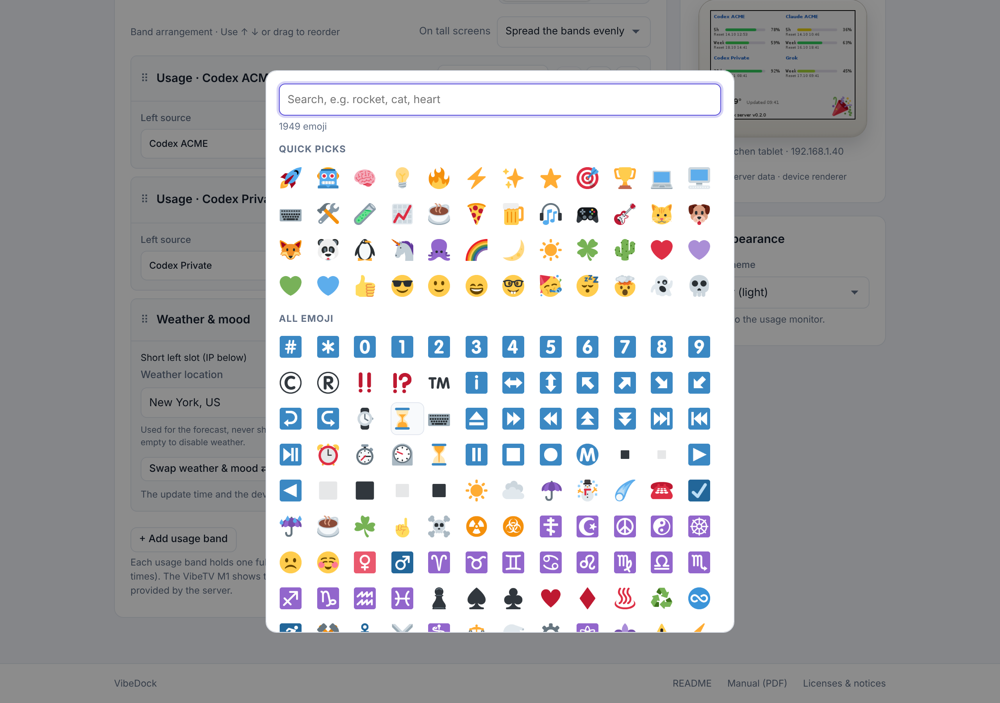

### Recovering a theme in the editor

**Discard unsaved changes** returns the whole draft to the state at opening or the last save, including an invalid
name, color or decoration edit. It does not change the installed package.

**Restore a built-in appearance** lets you choose a protected built-in template and restore its drawing, window,
bar and decoration settings. The draft's name, version and icons stay in place. This also repairs the appearance
of an already saved custom theme. Choose **Save theme** only when the preview is right; restoration itself does
not install or change a package.

**Sharing and version details** contains the technical ID, version, author/license and optional authoring-guide
setting. Low-level drawing operations live under **Advanced: decorations and borders**.

## Importing and sharing themes

Under **Display › Themes**, **Export** downloads a small compressed `.vibetheme` ZIP with the theme definition, its
icons and licenses. **Include agent guide in exports** adds a short reference prompt and format schemas for developing
the theme with a coding agent. Uncheck it for the smallest file. After extracting the archive, open **preview.html** for an offline view of the real renderer snapshot and included icons; no scripts or external resources are needed. The server never executes that text or invokes an
agent; no accounts, device settings or firmware are added to the export.

**Import theme** checks a package before installing it. A new ID can be installed directly. For an existing installed
ID, use **Update existing** with a newer version, or **Install independent copy** with another ID/name. Built-in themes
can only be copied. The live catalog changes immediately; **Use theme** selects it for the current design. Updating a
selected theme affects its next image without a server restart or firmware update.

**Remove** is available only for installed themes that no design or fixed icon uses. Change those selections first;
keep at least one theme enabled. An invalid import leaves the working package intact. If a package file is missing
or damaged at startup, its saved selection is kept and Midnight shows temporarily; restoring the same ID recovers it.
Packages persist in the data directory under `themes/`; keep that folder with your configuration backups.

## Creating and editing a theme

In the theme gallery, **Customize** opens a built-in theme as an independent copy in a new tab. Its original stays
unchanged. For an installed theme, **Edit theme** prepares a newer version; **Create copy** gives it an independent ID.

1. Set a theme name. Copies get a new ID automatically. **Sharing and version details** contains the ID, version and theme author/license. Keep attribution and license notices for artwork you reuse.
2. Change the design style, font and main colors under **Design**. Window styles have a separate **Windows** section for the surface, title bar, title text, border and controls. Bar/footer colors can follow the style or be
   customized where supported. Styles with text or palette-based bars use those colors instead of a bar override.
3. Add borders, shapes, grids or gradients under **Advanced: decorations and borders**. Each layer is behind the content;
   positions/sizes combine percentages of the image or usage band with pixel offsets. Order, opacity and corner
   radius are adjustable. Existing decorations stay unchanged unless you edit them.
4. Enter the actual **Creator** for your own uploaded artwork; its optional icon license is separate from the theme author. Twemoji attribution stays only for retained Twemoji artwork, including catalog alternatives.
   The **Default theme icon** is the one shown by Theme default. **Additional catalog icons** contains optional
   alternatives, including a preserved legacy illustration. **Replace artwork** changes an icon; **Add icon** extends
   its catalog. Upload PNG / SVG up to 128 KiB. SVGs are cleaned and retain their vector format; a removal notice means
   details may have changed, so check the preview. XML entities and graphics with no static shapes are rejected. Selecting the radio button previews that icon as the theme default.
   **Use a uniform SVG color** optionally replaces every painted fill and stroke with the chosen color. The visible
   color picker starts with a sampled source color. Vector format, opacity and unpainted areas stay intact. Uncheck
   to restore the source colors from this editing session; after saving/reloading, the saved SVG is the new source.
   Source credits remain attached when recoloring inherited artwork.
   For single-color PNGs with transparency, **Override main color** changes the color while preserving alpha. Multicolor or opaque PNGs keep their colors.
   Emoticon selections on devices are unaffected; users can select Theme default or a fixed Theme catalog icon.
5. Check **Preview** for the desired panel size. It uses sample readings and the actual device renderer.
6. **Save theme** installs the new theme or updates an installed one. It does not select it for a device; return to
   **All themes** and choose **Use theme**. Updating an already selected theme affects its next image.

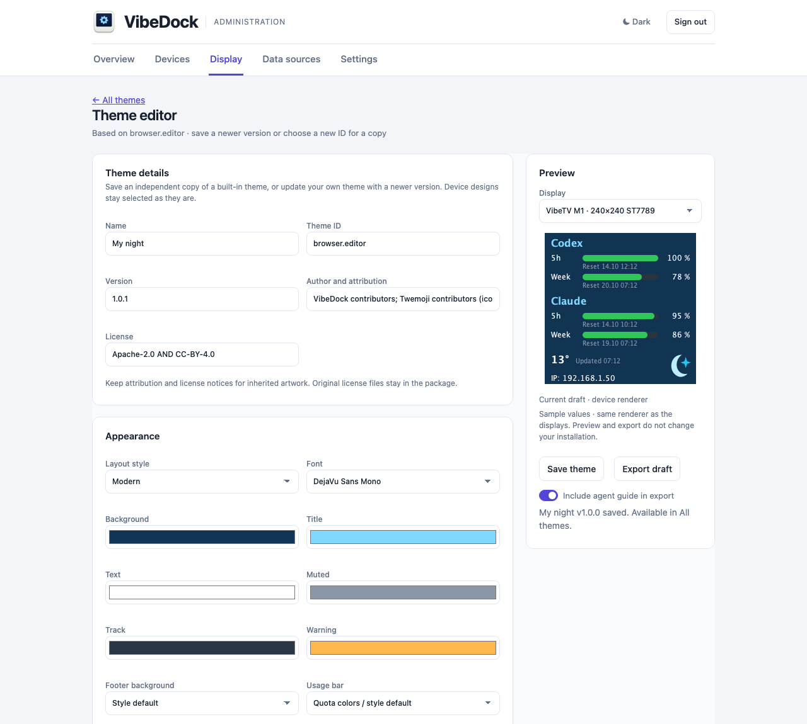

When an uploaded icon has no creator yet, **Save theme** / **Export draft** asks for it in a dialog. **Remember a contributor on this server** optionally stores an editable suggestion for future uploads; each new icon still needs confirmation. The inline **Remember creator** button does the same for a name already entered. **Forget saved contributor** clears the suggestion. A saved theme retains its own icon credits independently of this preference.

The theme editor does **not** save automatically. **Export draft** downloads your current work without installing it;
its optional agent guide is the same as on gallery exports. Leaving an edited page warns before discarding changes.
If another editor updated or removed the source, saving is rejected and your controls stay intact: keep that tab open,
reopen the current theme in another tab, compare and reapply the changes. Original license files travel with copies.

## What the displays show

The demo installation's four displays, as the server renders them:

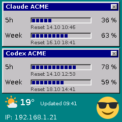
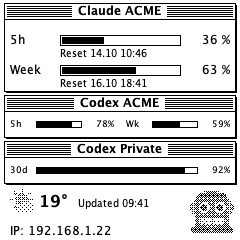


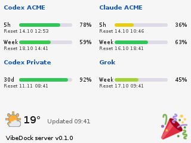

# Data sources


Every provider account is a data source with its own name on the display. Several accounts of one provider are
possible (e.g. *Claude ACME* for work and *Claude Private*). Cards can be reordered with the grip. The card shows the
sign-in state and whether current usage is available.

## Adding and signing in

**Add data source**: choose the **Type** and the **Name on the display**. Codex, Claude, Grok and Gemini sign in
after adding; Cursor needs the team's Admin API key and the member's e-mail.

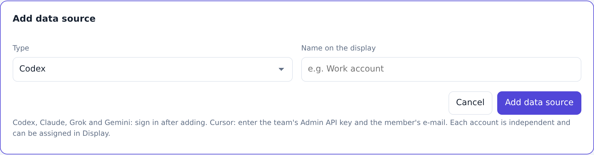

**Manage** opens the source: **Sign in with …** starts the browser sign-in of the provider; afterwards the
credentials are stored in the server's data directory, separately for every source. Use it again to renew expired
or revoked credentials. **Enter token manually** is the fallback without browser sign-in. **Pause data source**
stops polling (the display shows it as paused), **Remove data source** deletes it with its credentials.

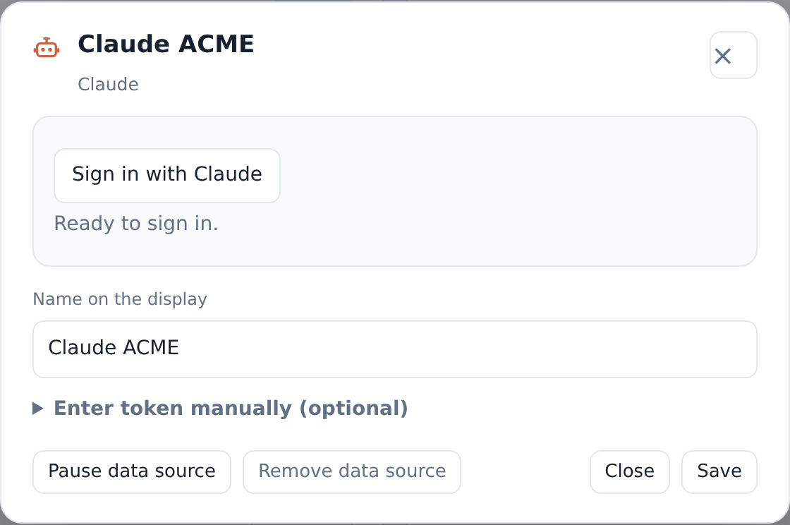

<!-- page break -->

## Update interval

The server asks every source for its usage on its own schedule; **Updates** on the source's card shows the current
interval. **Update interval** below the sources sets how it is chosen:

- **Dynamic** (default): every source learns how often its provider answers. A *rate limited* answer (HTTP 429)
  makes its interval one minute longer, up to the **longest** interval; only the next request waits twice as long.
  After an hour without a rate limited answer it tries one minute less, down to the **shortest** interval. If that
  is rate limited again, it goes back up and waits two, then four hours before it tries again. The card marks such
  an interval as *learned*; the server log shows every change (`interval 2 → 3 min`).
- **Fixed**: every source is asked at the shortest interval. After a rate limited answer its interval doubles, up
  to the longest one; every following answer halves it again, step by step down to the shortest.

Shortest and longest are 1 to 60 minutes (default 1 and 10). While a source is rate limited, the display keeps its
last values and shows *Rate limited*.

## Export and import

**Export** writes all data sources with their stored sign-ins into one file, encrypted with a password of at least
10 characters. Without the password the file cannot be restored.

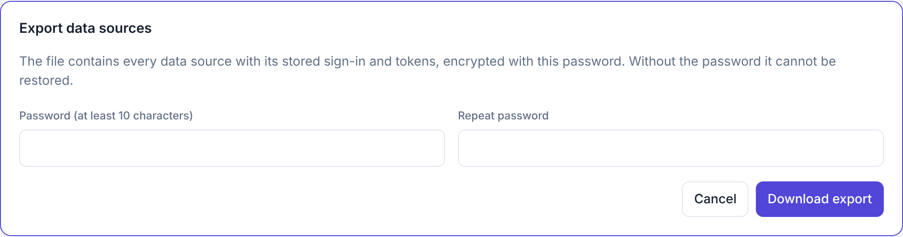

**Import** opens such a file with its password; you review the contained sources before anything changes.

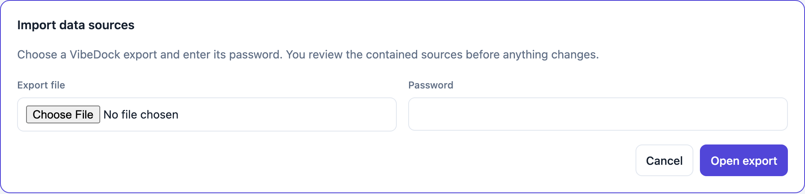

<!-- page break -->

## How little data a display needs

The server renders every picture completely, but a display with current firmware only receives what changed, and
only when something can have changed:

- **Changed parts only.** The server keeps the last pictures of each display in memory and sends just the changed
  spans of rows: usually a few hundred bytes to a few KB instead of 112.5 KB for a 240 × 240 picture. Whole pictures
  still come after a start, a theme change, a forced refresh, for slideshow photos and whenever the display or the
  server is not sure what the display shows.
- **Rest only after an abort.** If a picture breaks off on the way (weak Wi-Fi), the display keeps the rows it has
  and asks only for the rest; the server log shows `delta resumed`.
- **Turns without a new picture.** Displays with an ESP32 that have the memory for a copy of their picture turn it
  themselves when you change *Orientation* (or the colour correction) and then get only the normal changes.
- **Pulls when new readings are due.** Every answer tells the display when its picture can change next: shortly after
  the next poll of the sources it shows. The display pulls then instead of every 30 s; while a source is still being
  asked, it comes back a few seconds later. At most every 10 minutes (2 minutes if the server cannot reach the display
  directly), so design changes and status still arrive.

Measured on a Waveshare 1.54 with readings every minute: 16 picture updates in 20 minutes took 20 KB instead of
1.84 MB of whole pictures (98.9 % less); the typical update was 0.2 to 3 KB, a design change in the editor 4 to 12 KB.
The figures count the picture data, not HTTP headers or TLS. The server log shows each transfer with the bytes saved
and the announced next pull (`Image transfer …: delta, full=115200 bytes, payload=638 bytes, saved=… (99.4%),
next=58 s (current)`). Older firmware keeps receiving whole pictures every poll interval; a firmware update over
Wi-Fi is all it takes.

# Settings

**Settings** holds the server's network addresses, who may read its API, the old push connection, the
administration password, hardware display color rules and where it stores its data. **Save network settings** saves the network block, **Save access settings** the API access and the
legacy connection.

## Network

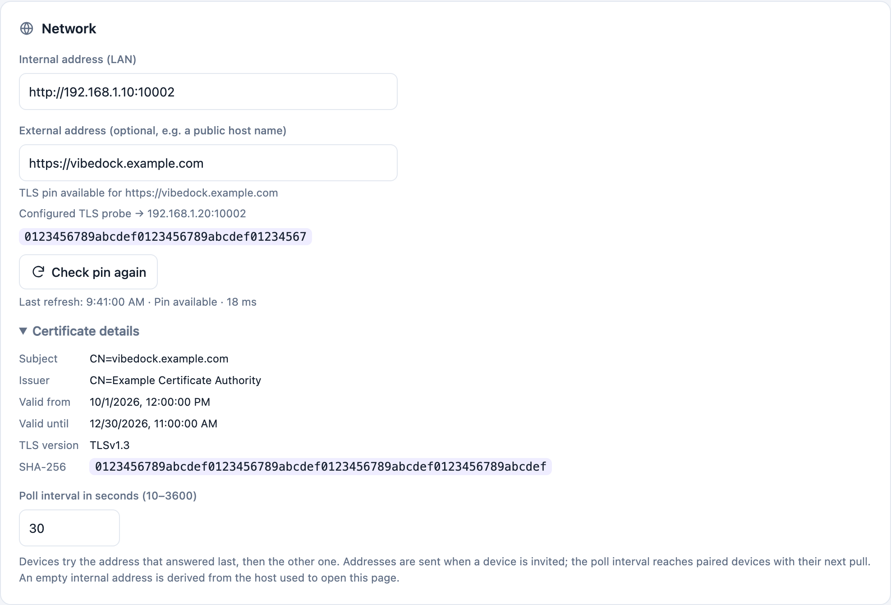

The **internal address** (LAN) and an optional **external address** (e.g. a public host name) of the server's
public port 10002. Without an internal address the server takes the one this page was opened with. The addresses
are sent to a display when it is paired: it tries the address that answered last, then the other one, so a display
moves between home and away by itself. After a restart it tries the first one (the internal address) once more,
without an error message when that fails, so a restart is enough to bring it back to the LAN. The **fallback poll interval** (10–3600 s, default 30) reaches paired
displays with their next pull. Current firmware does not pull in this rhythm: every answer tells it when its picture
can change next, after the next poll of the sources it shows (all sources are polled together on the full minute, so
several providers do not make it pull more often). The interval applies to older firmware, after a failed pull and
before the first answer, and as grace before *Updates missing*. Web display links use these addresses too.

## Read-only API access

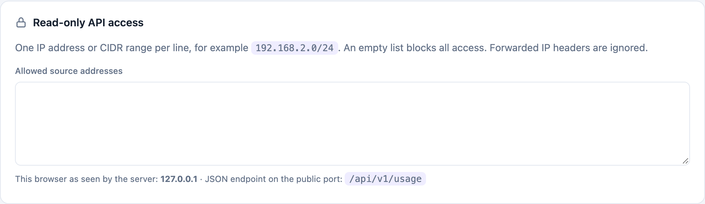

IP addresses or CIDR ranges that may read `/api/v1/usage` as JSON (for scripts and dashboards). An empty list
blocks all readers; it does not affect paired displays. Forwarded IP headers are ignored.

## Legacy connection

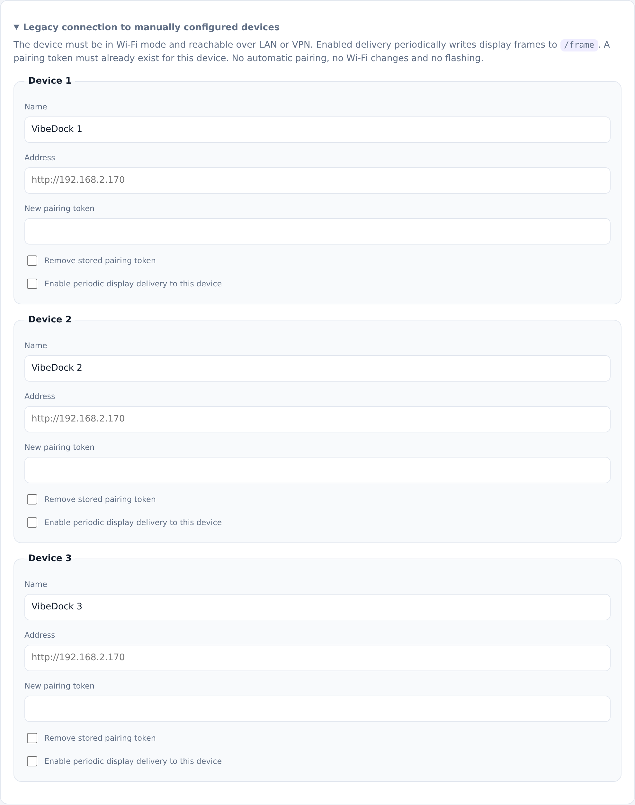

Only for old firmware that receives images pushed to `/frame`: up to three devices with name, address and pairing
token. Current displays pull their image and need nothing here.

## Administration sign-in

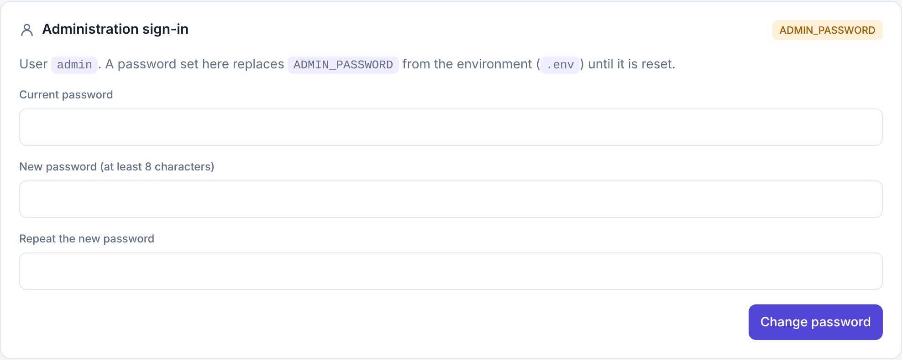

Changes the administration password with the current one. The new password (at least 8 characters) replaces
`ADMIN_PASSWORD` from `.env`; the server keeps only its hash in the data directory (`admin-password`), so it stays
after updates. The badge shows which one applies. **Back to ADMIN_PASSWORD** deletes the own password again. If the
own password is lost, delete `admin-password` in the data directory and restart the server; `ADMIN_PASSWORD`
applies again. Changing or resetting the password signs out every session, this one included; sign in again
with the new password.

## Hardware display colors

Use **Settings → Hardware display colors** to define ordered size rules. Each rule sets maximum width, maximum
height and 32, 64, 256 or full colors. Both dimensions must fit; the first match wins. Move rules with the arrows,
remove one with ×, then save. **Restore defaults** restores 420×420 → 32 and 640×640 → 256. Unmatched sizes use
full colors; removing every rule disables lossy reduction. Rules are stored in `DATA_DIR/image-colors.json`.

**Allow quality fallback** is the only automatic-quality switch. The server compares reference scenes for all installed
themes across small display sizes and derives a quality target internally; no percentage must be adjusted by hand.
It can move one palette level down or at most one up. A 32-color rule can therefore use 16, 32 or 64 colors. It
checks changed weather/icon pixels again; the target is a visual-quality heuristic, not a guarantee of identical
appearance. During initial calibration one conservative higher level is used without blocking device pulls.

Unused colors are always removed losslessly, with or without automatic quality. A four-color LCD image is sent
with four entries and two bits per pixel, even with a 32-/64-/256-color rule. Theme base/window colors, active/inactive bar colors and weather/
mood hues receive priority in lossy palettes. Web displays and browser previews keep full-color pixels; PNG
storage uses an exact palette only when smaller. Older firmware still receives the original RGB565 format.

The decoder reuses its row buffer with one 512-byte palette and no extra framebuffer. At 240×240, 32 actually
used colors need 36,066 bytes instead of 115,200; four colors need 14,410 bytes. Deltas use the smallest exact
palette of their spans without another color reduction. The server sends whichever supported full/delta variant
is smallest, with existing row checks and interrupted-transfer recovery.

Image fingerprints cache the palette, metric and encoded frame until pixels or policy change. The cache is
bounded to 64 entries and 8 MiB of image payloads; eviction or restart requires a new calculation.

**Live color comparison** opens `/admin/color-preview`: inspect all themes using current server data or clearly
labelled reference scenes. Switch resolution, fixed/native size, palette or automatic quality for all cards together.
The ↑ / ↓ icons show a larger/smaller palette; tooltips explain them. Each card shows actual colors, bits and bytes.
The Web option defaults to lossless. Reference scenes never query providers or change device settings.

### Much smaller full images and partial updates

Color reduction and partial images work together. The server renders the complete new image, chooses its hardware
palette and keeps that resulting image as the reference for the next update. It then sends only the changed spans
when that is smaller. The partial image receives its own exact palette of the colors actually needed in those spans;
this second compression does not change pixels again. If a complete image is cheaper, the server sends that instead.

For a 240×240 display, the original RGB565 full image is **115,200 bytes**. The following full-image sizes include
the palette and its count; they assume the stated number of colors is actually used:

| Actual colors | Bits per pixel | Full-image bytes | Reduction versus RGB565 |
| ---: | ---: | ---: | ---: |
| 256 | 8 | 58,114 | 49.6% |
| 32 | 5 | 36,066 | 68.7% |
| 16 | 4 | 28,834 | 75.0% |
| 4 | 2 | 14,410 | 87.5% |
| 2 | 1 | 7,206 | 93.7% |

A hypothetical four-color update covering one 40×10-pixel span needs only **160 bytes**, including its palette,
section header, row checks and terminator. That is 98.9% less than the four-color full image, or 99.86% less than
the original RGB565 full image. Actual partial-image savings depend on what changed; this is a calculated example,
not a measured typical transfer. Unchanged images can use HTTP 304 without an image body.

These figures describe image bodies, excluding HTTP/TLS/network overhead and retransmissions. They reduce the
bytes a slow or weakly connected display must receive; they do not guarantee a particular download time. The device
still expands the pixels and draws them using its normal display path.

**Checking your own installation:** the server's `Image transfer` log names the mode, original RGB565 full size,
actual payload and byte/percentage saving. `palette-K` means K colors were actually transmitted. In **Live color
comparison**, compare the original full frame, optimized full frame, changed-pixel percentage and actual color count.
Do not compare a PNG file size directly with hardware payload size: they are different formats. The comparison
page does not simulate the exact history of a particular device's partial updates; use transfer logs for those.

Install both the new server and compatible firmware to obtain indexed hardware transfers. An older display keeps
working with RGB565 and its supported partial-image protocol. Web displays and browser previews always keep their
rendered colors; their PNGs are indexed only when it is pixel-identical and smaller. Hardware quantization can be
visually close but remains lossy; subsequent palette shrinking and partial-image packing are exact relative to it.

The automatic selector reserves present theme/window colors, weather and mood artwork paints, and active/inactive
bar paints including rare Hi-Fi yellow/red segments. This keeps important small accents from being replaced merely
because background pixels dominate. There is a finite shared color budget: inspect unusually rich custom themes
and use a larger palette or full colors when necessary.

For formulas, protocol details, cache invalidation and future changes, see the
[technical image-pipeline reference](../design/image-color-pipeline.md).

## Storage

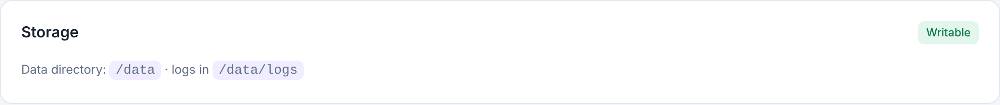

The data directory and the log directory, and whether they are writable. *Not writable* means the server cannot save
settings or sign-ins; check the mount and its owner (see [Data directory and backup](#data-directory-and-backup)).

# Installing the firmware

> **Flashing is at your own risk** (see [Disclaimer](#disclaimer)). Always download and keep a full backup of the
> device first; it is the only way back to its current firmware.

**Devices → Firmware** holds the firmware of the server's version for every supported board. The **Board** in the
firmware card decides which image is shown, downloaded and installed:

| Board | Chip | Display | Hardware |
| --- | --- | --- | --- |
| VibeTV M1 | ESP8266 | 1.54" ST7789 240×240 | tested |
| Cheap Yellow Display (ESP32-2432S028R) | ESP32 | 2.8" ILI9341 320×240 | prepared |
| LilyGO T-Display | ESP32 | 1.14" ST7789 135×240 | prepared |
| LilyGO T-Display-S3 | ESP32-S3 | 1.9" ST7789 170×320 | prepared |
| Waveshare ESP32-S3-LCD-1.69 | ESP32-S3 | 1.69" ST7789V2 240×280 | prepared |
| Waveshare ESP32-S3-Touch-LCD-1.47 | ESP32-S3 | 1.47" JD9853 172×320 | tested |
| Waveshare ESP32-S3-Touch-LCD-1.54 | ESP32-S3 | 1.54" ST7789 240×240, CST816 touch | tested |
| Waveshare ESP32-C6-Touch-LCD-1.69 | ESP32-C6 | 1.69" ST7789V2 240×280 | tested |
| ESP32-C3 with ST7789 240×240 | ESP32-C3 | e.g. C3 SuperMini | prepared |

*Tested*: runs on real hardware (installation over USB, pairing, images; on the Waveshare boards also touch). *Prepared*: builds, with the settings the tested boards called for, but has not run on hardware yet.

How every board shows the same design, rendered by the server in the board's own screen size and drawn in the case
the administration uses for it. The boards marked *prepared, untested* have not run on hardware yet; their picture shows
what the server sends, not that the board displays it correctly:

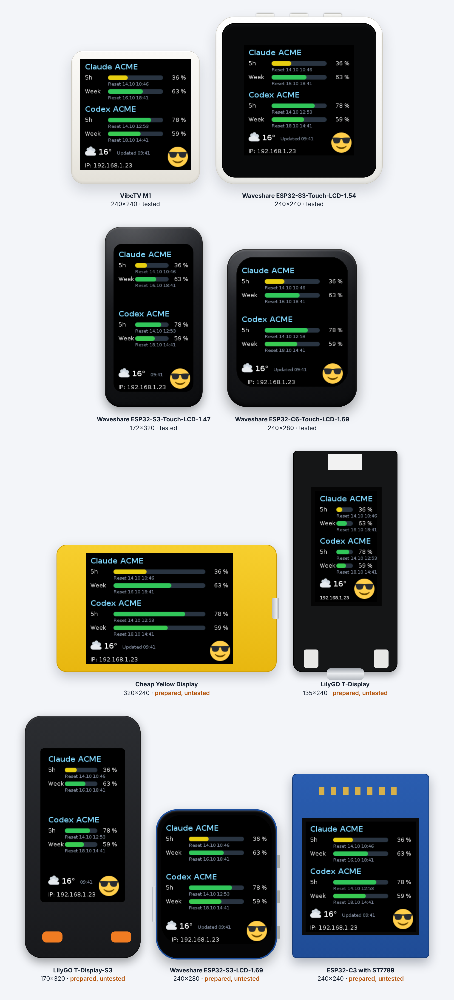

Below the board, the firmware card shows file, size, SHA-256, chip and flash address, and the displays of this board
with their installed version. **Download** saves the image; **Update to … over Wi-Fi** updates a paired display.

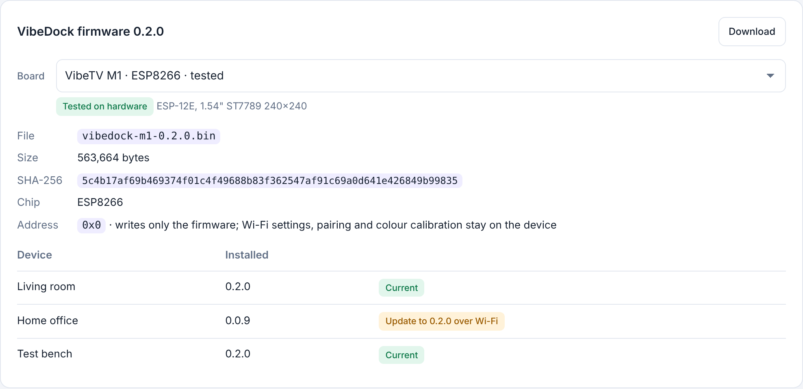

ESP32 boards get one image with bootloader and partition table:

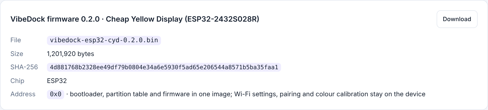

> The boards marked *prepared* compile and run the same code, but have not been tested on hardware yet.

## From the browser (recommended)

Needs Chrome or Edge on a computer, and the administration opened over HTTPS or on `localhost` (Web Serial).

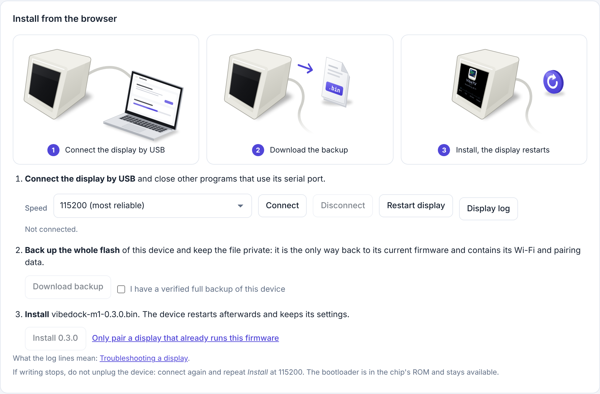

1. **Connect the display by USB** and close other programs that use its serial port (e.g. a serial monitor).
   Choose the **Speed** (115200 is the most reliable) and press **Connect**, then choose the display. The page checks the chip: when it is not the chosen board's and only one board of the
   installation has it (e.g. the ESP32-C6), the page switches to that board and connects again by itself; boards
   that share a chip (the ESP32-S3 boards) you choose yourself.
2. **Back up the whole flash** with **Download backup** and keep the file private: it is the only way back to the
   current firmware and contains the display's Wi-Fi and pairing data. Without a download, confirm that you have a
   verified full backup.
3. **Install** writes the firmware at 0x0. The display restarts and keeps its settings.

**Choosing the display.** The browser names serial ports by their USB chip (*USB JTAG/serial debug unit*, *USB
Serial*), which no firmware can change. Displays connected in this browser before are therefore listed by the page
itself, each with its name, identifier, board and firmware as it reports them over USB; *No VibeDock answer* is a
board with other firmware, one in its bootloader or a port in use elsewhere. **Another display …** opens the
browser's dialog for a new one; it lists only the USB chips of the boards, not the computer's other serial ports.
The same choice opens for **Restart display**, **Only pair** and **Read log over USB**.

After the installation the page offers to **pair this device now** over the same cable: enter a **Name**, choose
the **Wi-Fi** from the networks the display sees (**Refresh networks** scans again, for example after switching on a hotspot) and enter the **Wi-Fi password**, then **Send to the display**.
The password goes from the browser to the display only; the server never sees it. The display restarts, connects
and shows its image; no setup Wi-Fi and no pairing code are needed.

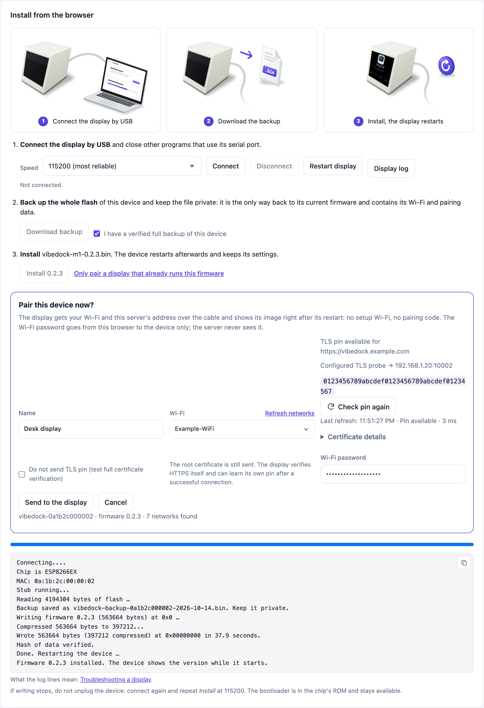

**Only pair a display that already runs this firmware** skips the installation; the same form is under **Devices → Pair device → USB**. **Restart display** restarts a
connected display. If writing stops, do not unplug: connect again and repeat **Install** at 115200; the bootloader
is in the chip's ROM and stays available.

## With esptool

Without Chrome or Edge, the page shows the esptool commands for the chosen board:

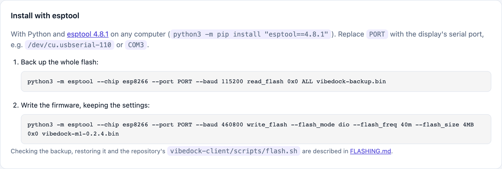

Backup, restore and the repository's `vibedock-client/scripts/flash.sh` are described in
`vibedock-client/FLASHING.md`.

## Updates over Wi-Fi

Paired displays are updated from the server: **Update to …** on the overview, the
device card or the firmware page. The display downloads the image, checks the server's signature and restarts; on
a problem it keeps the running firmware and reports the reason with its next pull.

## Own firmware build

**Own firmware build** on the firmware page replaces the built-in firmware of the chosen board with a build of your
own, for example a test version from your checkout:

1. Build it (`vibedock-client/scripts/build.sh <board>`, or IntelliJ).
2. Choose the files from `vibedock-client/firmware/.pio/build/<board>/`: `firmware.bin`, and on ESP32 boards also
   `flash.bin` (the USB image with bootloader and partition table). Press **Upload**.
3. The server reads version and board from the files and refuses a file for another board. From now on the page
   installs this build over USB, and **Update to …** offers it over Wi-Fi, signed with the server's key, to the
   displays of this board.

**Use the built-in firmware** removes the upload; the firmware of the server's version applies again. Only upload
firmware you built from these sources and trust: the displays install it.

# The display's own screens

Until a display has its first image, and during updates, it draws its own screens: logo, version, the state and
the progress of the start (**Wi-Fi → Pair → Server → Image**). The step in work spins, finished steps are green, a
problem is orange. The IP address is shown at the bottom.

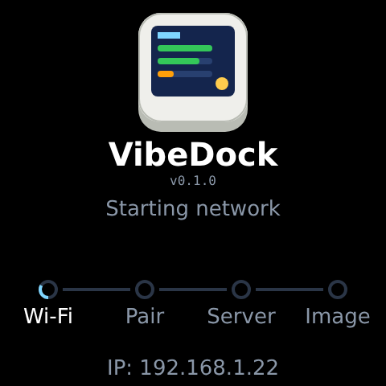
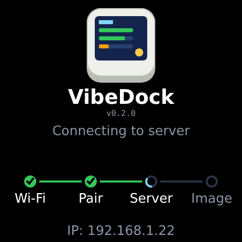
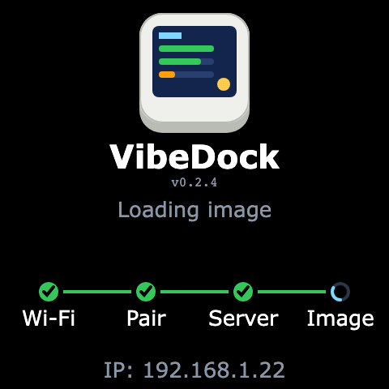

**Wi-Fi setup.** Without a saved network the display opens its own setup Wi-Fi. Scan the QR code with a phone: the
phone joins the setup network and the setup page opens; choose your network and enter its password. If the page
does not open by itself, open the address in the bottom row in a browser. The setup password is new every time and
only inside the QR code (the code in this picture is an illustration).

**Pairing.** Connected to Wi-Fi but not paired, the display shows the six-digit code; enter it with the IP address
under **Devices → Pair device**.

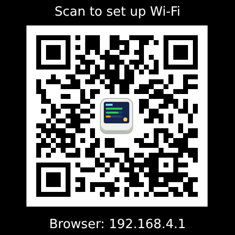
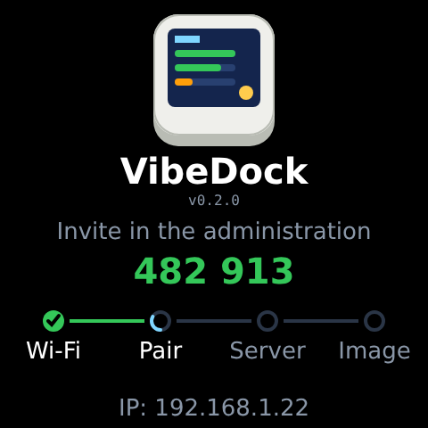
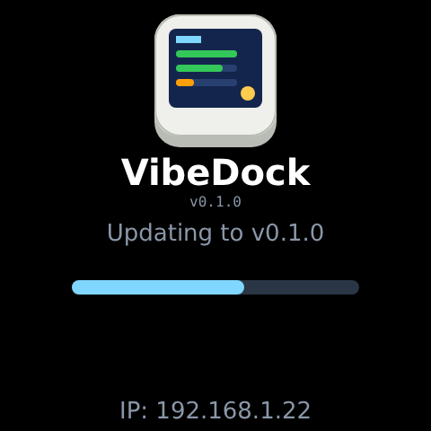

**Problems** are shown in an orange pill, with the reason below it where the display knows one. The same text is in
the display log ([Troubleshooting a display](#troubleshooting-a-display)), so a photo of the screen is usually enough for a report.

| Screen | Meaning | What to do |
| --- | --- | --- |
| *Network not found*, *Wrong password*, *Connection failed (WPA2?)*, *Network not reachable*, below *Waiting for …* | The saved network is missing or refuses the display. It tries again every 15 seconds and continues as soon as the network is back. | The ESP8266 uses 2.4 GHz only and needs WPA2 (WPA2/WPA3 mixed works, WPA3 only does not). A phone hotspot is only visible while its settings page is open. |
| *Server unreachable* with the progress row | Wi-Fi works, but no server address answered, and there is no detail. | Check the addresses under **Settings** and that port 10002 is reachable. |
| *Server unreachable* with a reason (table below) | Wi-Fi works; the reason says where the connection stopped. The bottom line names the address that failed, during the next attempt `trying <address>`. After a failure the display tries its other address right away. | See the reasons below. |
| *Image aborted*, with `no data for … s at row …` or `connection closed at row …` | The server answered, but the image did not arrive completely. While an image is shown, the display first retries once without this screen. | Mostly a lossy network (phone hotspot, weak signal). If it stays, read the log. |
| *Updates missing* | No successful pull for three polling intervals (90 s at the default), or two intervals after the time the server announced for the next pull; the old image is hidden so that no stale numbers show. | Check that the server runs; the log names the failing pulls. |
| *Update failed*, with the reason | An update over Wi-Fi did not install; the running firmware stays. The administration shows the same reason. | It is tried again after a restart of the display; otherwise install over USB. |
| *Unplug now for factory reset*, *or wait: Wi-Fi setup* | The second quick power cycle. | Wait to open the Wi-Fi setup (pairing stays), or unplug once more for a factory reset. |
| *Factory reset* | The third quick power cycle: Wi-Fi, pairing and server addresses are deleted. | Set the display up again. |
| *Storage error* | The display cannot read its settings from flash. | Install the firmware over USB again (after a backup) and pair it. |
| *Random source error* | The Wi-Fi setup did not open because no random password could be made; it never opens without one. | Restart the display; report it if it stays. |

In the Wi-Fi setup the top line shows the last Wi-Fi problem (`… - see page`).

Reasons under *Server unreachable*:

| Reason | Meaning and what to do |
| --- | --- |
| `name … not resolved (DNS)` | The host name of the https address is unknown in the display's network. |
| `no TCP connection to <ip>:<port>` | Nothing answers there. Normal for the internal address outside your LAN; otherwise the server is down or a firewall blocks the port. |
| `TCP to … works, TLS or HTTP failed` | The port answers, but the connection failed without a more precise reason. |
| `TLS 1.3 … certificate not trusted, root from pairing does not match` | The server's certificate does not lead to the root from pairing (new certificate authority, wrong reverse proxy). Pair the display again. The log names both roots. |
| `TLS 1.3 … certificate expired` / `not yet valid (clock?)` / `host name does not match` | The certificate of the https address is outdated, the display's clock is wrong, or the address does not match the certificate. |
| `TLS 1.3 … certificate is not the pinned one (renewed?)` | Normal after a certificate renewal: the display checks the new one fully right away and pins it. |
| `TLS 1.3 … out of memory …` | The display ran out of memory during the handshake. Send the log line. |
| `TLS 1.3 … alert from the server …`, `server does not speak TLS 1.3` | The server refused the connection; the alert names why. A server with TLS 1.2 only works on the M1 over its TLS 1.2 fallback. |
| `read Timeout (-11) after TLS; sent …, got … B …` | The encrypted connection worked, but the answer stalled (`got` bytes arrived). Mostly a lossy network; the display retries at once. |
| `no root certificate for https from pairing` | The display was paired without an https root. Pair it again. |
| `clock not set yet (NTP), needed for https` | The display has no time yet; it needs `pool.ntp.org`. It goes away after a few seconds. |

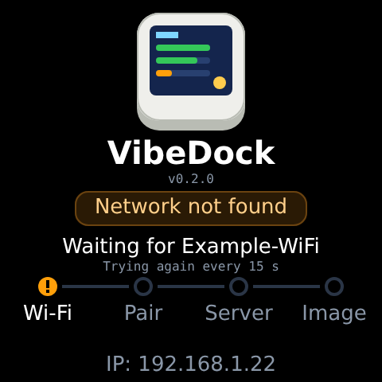
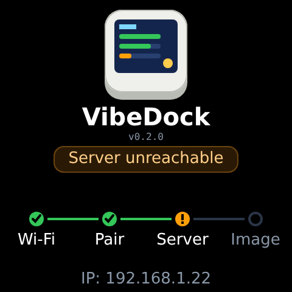
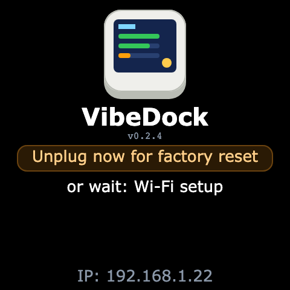

**Wi-Fi setup again and factory reset.** Unplug the display and plug it in again twice, each time within ten
seconds after power-on. The display then shows *Unplug now for factory reset*:

- wait, and it opens the Wi-Fi setup (the pairing stays);
- unplug once more, and it forgets Wi-Fi, pairing and server addresses (factory reset).

Starts over USB do not count: reading the log, pairing over the cable or flashing new firmware (both flashers
confirm the start of the M1 over USB) never add up to the Wi-Fi setup or a factory reset.

A display with a battery fitted (Waveshare 1.54) keeps running on it when unplugged; disconnect the battery first.

# Troubleshooting a display

Work from the display outwards: what the display shows, what its log says, then the server and the network.

## Look at the display

[The display's own screens](#the-displays-own-screens) tell where it stops: *Network not found* or *Wrong password* is Wi-Fi, the
pairing code means it is not paired, *Server unreachable* means Wi-Fi works but no server address answers. A display
that shows an image and the green status under **Devices** is fine; a stale image disappears after three missed
polls.

## Touch displays

Displays with a touch panel (Waveshare ESP32-S3-Touch-LCD-1.47, ESP32-S3-Touch-LCD-1.54 and ESP32-C6-Touch-LCD-1.69) react to swipes:

| Swipe | Effect |
| --- | --- |
| left / right | next / previous colour scheme; the display keeps it as its own design (*Custom design* in the editor) |
| up / down | brighter / darker (10–100 %), stored on the display |
| double tap | photos on or off: starts the slideshow of the display's design or stops it, whatever its schedule or the editor's switch say (until the next double tap or a restart of the server) |
| circle | turns the picture: a circle clockwise turns it clockwise, counter-clockwise the other way; by 90° on the square 1.54, between upright and upside down on the others. The device card shows the new orientation (see [Displays mounted upside down or turned](#displays-mounted-upside-down-or-turned)) |

Draw the circle with one finger in one go, at least about a third of the screen wide and within three seconds; it does not
have to be round or end exactly where it started. The scheme changes with the next image, right after the swipe. To follow the default design again, turn off
*Custom design* for the display in the editor.

## Sounds and battery on the Waveshare 1.54-inch touch display

This board's speaker plays short startup, connection, pairing and quota notifications. Open its local IP address
and use **Sounds** to set volume, mute or play the test tone. The physical **+ / - buttons** change volume in steps
of 10. Louder gives a short high beep, quieter a low boop; recognized swipes have a quiet sliding sound.
Every volume-button press briefly shows a bar and percentage on the display, or **Muted** at zero.
The notice disappears after 1.6 seconds and restores the picture without needing the server.
Zero mutes all sounds, including this feedback; the default is 30%. The setting is saved after three seconds and survives restarts.

With the updated server, every reported quota increase/decrease sounds, without thresholds. Full remaining
quota uses the rising tune, empty the low beep. Initial and unchanged readings stay silent. Only audio-capable
clients request the extra metadata, piggybacked on image replies; other devices get no extra header. Local tones
also work with older servers. Sustained connection loss and subsequent recovery sound once each.

The **Battery** card shows measured voltage, a coarse estimated level and the charging signal. Reload to take
another reading. These readings do not prove a battery is fitted or full while USB supplies power; battery
presence stays **Unknown**. USB serial command `VIBEDOCK-BATTERY` returns the same diagnostic values.
Tested on hardware: display colours, touch, audio, the short volume and swipe cues and the volume controls work.
Battery presence and operation without USB have not been established. No motion-based rotation or microphone recording is implemented.

### Battery power saving (experimental)

Displays with a battery connection have the switch **Battery power saving** on their device
card: Waveshare 1.54, 1.47 and C6 1.69 (tested boards), Waveshare S3 1.69 and LilyGO T-Display-S3 (prepared). It is
off by default. Switched on, the display saves power while it runs on its battery, that is without a computer on its
USB port (and on the 1.54 without charging):

- Wi-Fi modem sleep, which VibeDock otherwise switches off because some access points and phone hotspots then delay or
  drop packets; it stays off while the display pulls its picture (or loads an update), so transfers are not slowed;
- the processor at 80 MHz instead of 240 (C6: 160) MHz;
- the backlight dims to 10 % after a minute without touch or volume button. The next touch only wakes it; swipe again
  for the gesture.

Plugging into a computer ends it within about ten seconds. A charger or power bank without data lines counts as
battery operation, except on the 1.54 while it charges; that does no harm. The display's status page shows **Power
source** and **Power saving** (on the 1.54 in the *Battery* card, on the others in a *Power* card). Not yet tested
on hardware: how long a battery lasts with and without it, and whether every access point keeps up with modem sleep.
If the display misses updates on battery, switch it off again.

**Battery icon.** While one of these displays runs on its battery, its picture shows a small battery at the top right
of the first usage band (beside a status such as *Rate limited*, in window themes in the title bar), whether power
saving is on or not. The 1.54 and the C6 1.69 fill it to their measured level in steps of 20 %, red below 20 %; the others only know
that they run on battery and show three dots in it (level unknown), an empty frame means 0 %. The device card's preview shows it as well. On USB it disappears. The
server draws it into the image, so the display only sends one more header with its pulls; the image changes only when
the level steps or the power source changes. The LilyGO T-Display has a battery connection too,
but its USB serial chip cannot tell whether a computer is connected, so it has no power saving.

## Displays mounted upside down or turned

Every display except the VibeTV M1 (its case decides how it stands) shows its **Orientation** on its card under
**Devices**. The rotate button beside it turns by 180 degrees, on displays with a square panel (e.g. the Waveshare
1.54") by 90 degrees clockwise, and saves at once. On touch displays a circle drawn with one finger does the same, in the direction of the circle. The card shows the case as the display is mounted, the picture on
it upright. The display's own screens and the swipes turn as well; the
display takes it over within seconds. Displays with an ESP32 that keep a copy of their picture (the device log says
*Copy of the picture kept* after the first picture) turn it themselves without loading it again. Quarter turns need firmware that knows them: older firmware keeps its
orientation until it is updated. The motion sensor of the Waveshare boards is not used: it decided too unreliably.

## Read the display log

**Devices → Troubleshooting → Read log over USB** shows the display's last 24 events, for every board and firmware
(no board to choose, paired or not):
starts and their reason, Wi-Fi, pairing, every change of the server's answer and why a connection failed. It holds
no keys or passwords. The copy button next to the log copies it for a report.

Every log read this way is also saved on the server. On the same page, each paired display links to its last 10 logs
with the time they were read and how (USB or network), to show, download as text or delete. Removing
the display removes its logs.

On a display's log page, **Key figures** compares the logs: per log the lowest free memory, the free memory after a
TLS handshake and its stack, the slowest complete picture, pictures shown and aborted, and the Wi-Fi signal, with the
change against the log before in brackets. When a log is saved, the server also keeps its own log entries about that
display from the same time: image transfers (delta or full, bytes, next pull), starts, saved logs and updates. The
switch **Server lines** on a log shows them between the display's lines, in the accent colour, with all times in
server time; while it is on, **Download** includes them too. Logs without such entries have no switch.

The table also shows how fresh the **newest log** is: how long ago the server received it (server time; its lines can
be much older), over USB or the network, the firmware it came from and, with firmware 0.2.0, the start it was sent in
(boot id and run time). *Older firmware than now* marks a log from another firmware than the display runs today: read
a current one before drawing conclusions. Below the display's name: its current start (run time, free memory and its
minimum, Wi-Fi signal) and how the last start came about (*power-on*, *update*, *external*, *crash*, …).

**Read over the network** there asks the display to send its log without a cable: it sends it right
after its next image pull, over the same address and encryption as its images, within seconds when the server can
ask it to pull now. This needs firmware newer than 0.1.1; older firmware sends its log only over USB. The request is
valid for 10 minutes and for one log. While it is open, the log page says whether the display was asked to pull at
once, when its next pull is due (the one the server announced, otherwise the last pull plus the fallback poll
interval) and how late it is, and counts down to the end of the request.

> Opening the USB port restarts the VibeTV M1. Read the log only after the display has finished what you want to
> see: it shows an image or *Server unreachable*. An https connection takes the M1 a few seconds, and the first
> attempt at an address can come only with the next pull.

| Log line | Meaning and what to do |
| --- | --- |
| `Start v… board: boot=… reset=… start=power-on prev=unknown; Power on` | A start (firmware 0.2.0): its boot id, the platform's reset code and its kind. After a power cut the run before is unknown. |
| `… start=update prev=… phase=ota …` / `start=setup` / `start=factory-reset` / `start=low-memory` | A restart the display planned: not a crash. |
| `… start=external …` | The reset button, or a USB port that was opened (esptool, serial monitor, *Restart display*). |
| `… start=crash` / `watchdog` / `software` / `brownout` `prev=… phase=image up=5400 heap=…/…` | An unexpected restart and what the display was doing before (`phase`), how long it ran and its free memory then. On the M1 a crash record follows (`exception (reason …, cause … at 0x…)`). Report it with the firmware version; see `vibedock-client/FLASHING.md`, *Decoding a crash*. |
| `Start v… board, Power on` / `External System` / `Software/System restart: stack overflow …` | The same from firmware up to 0.1.1, without boot id and kind. |
| `USB console: this start is not counted as a power cycle` | Normal after reading the log: USB starts do not count towards Wi-Fi setup or factory reset. |
| `New firmware: this start is not counted as a power cycle` | The first start after installing a new firmware; the resets while flashing do not open the Wi-Fi setup. |
| `Second quick power cycle: …`, `Factory reset after …` | Two or three short power cycles opened the Wi-Fi setup or reset the display. |
| `Wi-Fi: Network "…" was not found …` | The network is not visible on 2.4 GHz (5 GHz only, hidden, out of reach, phone hotspot asleep). |
| `Wi-Fi: Wrong password for …` / `Connecting to … failed …` | Password, or a network that needs WPA3 only or required PMF. |
| `Wi-Fi …: <IP>, -60 dBm, heap …` | Connected; the signal (better than -75 dBm) and the free memory. |
| `<address>: connection failed, no TCP connection to <ip>:<port>` | Nothing answers at that address and port: outside the LAN this is normal for the internal address; otherwise check that the server runs and the port is open. |
| `… name <host> not resolved (DNS)` | The host name of the https address is unknown to the display's network. |
| `… TCP to … works, TLS or HTTP failed` | The port answers, but TLS or HTTP failed without a more precise reason. An ESP32 board against a server that offers only TLS 1.3: allow TLS 1.2 on the server for ESP32 boards. |
| `… after TLS; sent …, got …` | The encrypted connection works; the HTTP request failed afterwards (for example read timeout or connection lost). Check the reverse proxy and the server's access log for the request. |
| `Image shown, read in … ms` | The first image after a start or a problem arrived completely. |
| `Image aborted: no data for 8 s at row …` / `connection closed at row …` | The answer started but the image did not arrive completely; over https the traffic figures follow. Often, with a good signal: see [Slow pictures and aborted transfers](#slow-pictures-and-aborted-transfers-wi-fi). |
| `… TCP to … works, no HTTP answer` | The connection was set up but the request or its answer got lost; the server's access log does not list the request. Now and then is harmless; often: see [Slow pictures and aborted transfers](#slow-pictures-and-aborted-transfers-wi-fi). |
| `Image aborted: invalid delta, length or checksum` / `delta transfer interrupted` / `unsupported image or delta basis` | A partial update did not fit what the display shows or did not arrive completely; the display fetches the whole picture right away. Now and then is harmless; every time points to a proxy changing the answers. |
| `Image not accepted: format …, … bytes announced` | The server's answer was not a VibeDock image: no or a wrong image format, typically a wrong address or a reverse proxy that answers itself. A missing `Content-Length` is fine. |
| `Trying <address> next` | The display switches to its other server address. |
| `Clock set (NTP)` | The time is known; https needs it. Without this line check that the display can reach `pool.ntp.org`. |
| `… clock not set yet (NTP), needed for https` | As above: no time yet, so no https. |
| `… no root certificate for https from pairing` | The pairing did not include a root for the https address. Check the warning under **Devices** and pair again. |
| `TLS 1.3 -0x7780 alert from the server 40 (handshake failure)` | Server and display share no algorithm (see the supported algorithms in `vibedock-client/TLS.md`); report the log. |
| `TLS 1.3 -0x2700 certificate not trusted, root from pairing does not match` | The server's certificate now leads to another root (new certificate authority): pair the display again. |
| `… certificate expired` / `not yet valid (clock?)` / `host name does not match` | Renew the server certificate, check the time, or use the host name the certificate is for. |
| `TLS 1.3 -0x7200` (firmware before 0.3.3 also lists every certificate problem at once) | The address answered, but not with TLS, before any certificate was checked: typically the external https address tried from inside the LAN. Harmless when the internal address works. |
| `TLS 1.3 -0x6800 timeout after …` | The server stopped answering during the handshake (15 s without progress). Check the reverse proxy. |
| `TLS 1.3 … out of memory`, `needs … bytes for its stack`, or `-0x6E00 handshake failure` with a small `block` | Too little free memory on the M1. Report the log with its heap figures. |
| `Server refuses TLS 1.3, using TLS 1.2` | The server speaks only TLS 1.2; the display uses it with the same certificate check. |
| `<address>: HTTP 200, TLS 1.3 …` | Works: cipher suite, duration and memory of the connection. |
| `<address>: HTTP 400 "<html>…"` | A reverse proxy answered, not the VibeDock server (the text is the start of its page). Check the proxy's target and that the display really speaks TLS to the https port. |
| `Server rejected the device key (401), 1 of 3` | The server did not accept the key. After the third answer like this in an unbroken row the display removes its pairing; any other answer, or none, starts the count again. |
| `Server rejected the device key (401) three times: pairing removed` (before 0.3.3: `… (401): pairing removed`) | The server does not know the display (removed, or another server): pair it again. |
| `Restart: too little memory in one piece (largest block …, heap …)` | The M1 had too little memory left for a TLS connection three pulls in a row and restarted itself (`start=low-memory`). Now and then is harmless; often: report the log. |
| `Update to v… started` / `installed` / `Update failed: …` | Updates over Wi-Fi and why one failed; the running firmware stays on failure. |

## Slow pictures and aborted transfers (Wi-Fi)

**Signs:** the display log shows `Image aborted: no data for 8 s`, `delta transfer interrupted` or `TCP … works, no
HTTP answer` again and again, a whole picture takes several seconds instead of about one, and the display still has a
good signal (better than −60 dBm) and no Wi-Fi drops. **Devices** shows many whole pictures instead of small changes.

**Cause:** a crowded 2.4 GHz channel. The signal is strong, but many packets have to be sent again. The VibeTV M1
(ESP8266) suffers most: its small receive window cannot recover a lost packet quickly, so each loss stalls the
transfer for a second or more, and a few losses in a row exceed the 8 s limit. ESP32 boards in the same network show
little of it. Current firmware resumes a cut-off picture with its rest, so it still arrives, only slowly.

**Check** in your router or Wi-Fi controller: the load (airtime) and interference of the 2.4 GHz channel and the
retries of the display. In UniFi: **UniFi Devices** › the access point › **Radio Settings** (*Live Airtime*) and the
client's *TX Retries*. Airtime far above 50 % or retries above 10 % on the display's channel point to this cause.

**Remedies:**

- Spread the access points over the 2.4 GHz channels 1, 6 and 11 and do not lock all of them to one channel (UniFi:
  *Lock 2.4 GHz to Channel …* in the Wi-Fi settings); choose the channel with the least load from the controller's
  scan of the neighbourhood.
- Keep 20 MHz channel width on 2.4 GHz.
- For a Wi-Fi network of displays: 2.4 GHz only, WPA2, Wi-Fi 4 mode (UniFi: *Force WiFi 4 Mode*), and no MLO,
  802.11r/v or band steering.
- Firmware before 0.3.3: many aborted pictures can exhaust the memory of the M1 until it sends its request without a
  whole key and removes its pairing on the server's answer. Update the displays; 0.3.3 keeps the pairing and restarts
  the display when memory runs low.

**Displays in their own VLAN** (e.g. an IoT network): allow only the displays to reach the server's device port, for
example in UniFi a zone *IoT* whose traffic to *Internal* is blocked, with one *Allow* policy from the displays' IP
addresses to the server's IP and port above it. Open that subnet in the firewall of the server host as well (Synology:
**Control Panel** › **Security** › **Firewall**), and make sure the host sends its answers back through the router of
that VLAN (its default gateway). The displays keep using the internal address; nothing changes in their pairing.

## Check the server

- **Devices** shows each display's last pull, IP, firmware and warnings of its pairing (e.g. an https address the
  server could not get a certificate for).
- The server log (`logs/vibedock.log` in the data directory) records pairings, updates and rejected pulls. The access
  log (`logs/access*.log`) lists every request on both ports: a display request that is missing there never reached
  the server, so a reverse proxy or the network stopped it.
- From a computer outside the LAN, check which TLS versions the external address offers:

  ```sh
  openssl s_client -connect vibedock.example.com:443 \
      -servername vibedock.example.com -tls1_3 </dev/null
  openssl s_client -connect vibedock.example.com:443 \
      -servername vibedock.example.com -tls1_2 </dev/null
  ```

  `protocol version` in the answer means that version is not offered. The VibeTV M1 needs TLS 1.3 or 1.2, the ESP32
  boards TLS 1.2.

## Try a test build

To test a fix before a release, build the firmware from your checkout and install it with
[Own firmware build](#own-firmware-build), over USB or over Wi-Fi. Go back with **Use the built-in firmware**.

## Report a problem

**Request current logs** first asks every display that can for its log, so that the file holds current ones: nothing
is read from a display without it. The list shows per display whether its log arrived, is still awaited (a display
that cannot be reached at once sends it with its next pull), timed out after 10 minutes, or can only be read over USB;
saved logs stay either way.

**Devices → Troubleshooting → Create support file** puts what a problem needs into one file: your description of the
problem (one line, what happened, what you expected, the steps to see it again, since when, the displays concerned),
a **diagnosis** per display (the firmware it runs and that of its newest log, how old that log is, its last start and
the run before, memory and Wi-Fi; separately what was *observed*, what that *suggests* and what data is *missing*, e.g.
a panic backtrace that only the serial port shows), the server's warnings and errors, version and platform,
the data sources (without sign-ins or keys), the displays, the server and access log of the chosen days and the
saved display logs. Keys, tokens, display links and e-mail addresses are removed; *Also hide host names and public IP
addresses* removes those as well (addresses in the home network stay). The file is encrypted with a key that the page
shows once and does not keep: attach the file to the issue and send the key separately, never in the issue.
Server and access logs are collected automatically for the chosen period (1–14 days), including available rotated
server logs. Each of these two blocks keeps at most the newest 3,000,000 characters; it is independent of the
500-line troubleshooting preview. Missing log files produce empty blocks. Saved device logs are included when
their save time falls within the chosen period; the export does not read a new log from a display automatically.
**Displays concerned** marks which displays the problem affects; it does **not** filter the exported logs. The file
currently includes saved logs from all displays in that period, not only those selected.

**Open a support file** on the same page decrypts such a file with its key and shows its contents, the description
first; nothing of it is stored. *Raw (JSON)* shows the whole content as one document, *Copy as JSON* and *Download
JSON* hand it on, e.g. to an analysis tool.

Without a support file: copy the display log, and note the server version (page footer), the board and the firmware
version, and what the display showed.

# Regenerating this manual

The manual is built from `docs/manual/MANUAL.md` by `vibedock-server/scripts/docs.sh`. The script builds the server,
starts it with demo data (`DocsDemo` in the server's test sources: a fixed time of 14 October 2026, 09:41, made-up
usage per demo account, fixed weather, no request to any provider), brings the demo displays into their states over
the device API and photographs every page with Playwright. The display's own screens are drawn by
`e2e/docs/device-screens.mjs` the way the firmware draws them. Running the script twice gives byte-identical images
on the same machine; other machines may differ in font rendering.

```sh
cd vibedock-server
./scripts/docs.sh                                          # screenshots only
DOCS_PDF=../docs/manual/vibedock-manual.pdf ./scripts/docs.sh   # screenshots and PDF
```

- `DOCS_VERSION` sets the version shown in the pictures and the PDF (default: the version of the checkout).
- `DOCS_PDF` also makes the PDF; it needs pandoc, XeLaTeX (TeX Live) and the DejaVu fonts. Title page, page header
  and footer, headings and frames are defined in `docs/manual/style/manual.tex`. `keep-with-figure.lua` next to it moves a
  heading to the next page together with its first picture when both do not fit.
- `EMOJI_DIR` points to another Twemoji SVG folder (the 72×72 PNGs work too); without it the script uses the
  graphics versioned in the repository (`third-party/twemoji/svg`), the same as the server and the Docker image.
- `PLAYWRIGHT_CHROMIUM` uses an installed Chromium instead of Playwright's own.

**In the Docker image.** Every Docker build (Compose, `scripts/image.sh`, the release workflow) runs the same script
on the committed sources and puts the PDF into the image. The administration links it in the footer as **Manual
(PDF)**; it always matches the installed version. Its title page names the build: the version with the commits
since the last tag (e.g. `0.1.0-3-g503ce5c`), the commit and the commit's date; the screenshots show the same version. A build without the repository's `.git` (plain `docker build`)
has no manual and no link.

The READMEs show pictures from `docs/manual/images` as well, so they stay current with the manual.

After a change to a page, update the demo data in `e2e/docs/screenshots.mjs` if needed, run the script, check the
pictures and adjust this text. After a change to the firmware's screens, change `device-screens.mjs` along with
`main.cpp`.

# License

VibeDock is licensed under the **Apache License, Version 2.0**. You may use, change and pass on the software, also
commercially, as long as you keep the copyright and license notices and mark changed files. The full text is in
`LICENSE` in the repository and at <https://www.apache.org/licenses/LICENSE-2.0>; `NOTICE` holds the copyright notice.
The software comes without any warranty.

Third-party components keep their own licenses. The manual built with the Docker image (**Manual (PDF)** in the footer of
the administration) ends with the complete list of that build, grouped by license; **Licenses & notices** in the
footer also holds every license text. The most important ones:

| Component | Used for | License |
| --- | --- | --- |
| Spring Boot and other Java libraries | Server | Apache-2.0 and others (Maven report on the licenses page) |
| esptool-js (Espressif) | Flashing from the browser | Apache-2.0 |
| Codex CLI, Gemini CLI | Sign-in to the providers | Apache-2.0 |
| Claude Code, Grok Build | Sign-in to the providers | Licenses of Anthropic and xAI |
| Twemoji 17.0.3 graphics (Twitter, Inc. and other contributors; unmodified, `third-party/twemoji`) | Emoji on the displays | CC BY 4.0 |
| Open-Meteo | Weather data | CC-BY 4.0 (attribution) |
| ArduinoJson, QRCode | Firmware | MIT |
| TFT_eSPI | Firmware, display driver | FreeBSD and MIT (per file) |
| Arduino cores for ESP8266 and ESP32 | Firmware | LGPL-2.1 and others |
| DejaVu fonts | Status images, this manual | Bitstream Vera / public domain |

This manual and its screenshots are part of the repository and fall under the same license.
