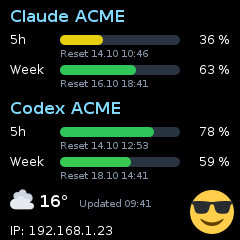

[VibeDock](../README.md) › **Client** · [Server](../vibedock-server/README.md) · [Backup & flashing](FLASHING.md) · [TLS](TLS.md) · [Repository](https://github.com/McFcologne/org.frifra.vibedock)

# VibeDock client firmware

Turn a compatible VibeDock display into a small Wi-Fi dashboard for your provider usage, weather and mood. The server handles accounts, data and design; the device receives the finished image and keeps its IP address visible.

The firmware targets the **VibeTV M1: ESP8266EX with 4 MB flash and a 240×240 ST7789 display**, the desk display sold by Vibe TV ([vibetv.shop](https://vibetv.shop/); not affiliated with this project). Wi-Fi setup, pairing, image pulls and colour calibration are in use on real hardware.

The same sources also build for ESP32 boards with a display: Cheap Yellow Display (ESP32-2432S028R), LilyGO T-Display, LilyGO T-Display-S3, Waveshare ESP32-S3-LCD-1.69, Waveshare ESP32-S3-Touch-LCD-1.47, Waveshare ESP32-S3-Touch-LCD-1.54, Waveshare ESP32-C6-Touch-LCD-1.69 and an ESP32-C3 with a 240×240 ST7789 (wiring and display types in [CLIENT-PROTOCOL.md](../vibedock-server/CLIENT-PROTOCOL.md#boards)). Each is a PlatformIO environment in `firmware/platformio.ini`; `firmware/src/platform.h` holds what differs between the chips. Tested on hardware: the VibeTV M1, the Waveshare ESP32-S3-Touch-LCD-1.47, ESP32-S3-Touch-LCD-1.54 and ESP32-C6-Touch-LCD-1.69. The other boards are prepared: they build and use what the tested boards showed, but have not run on hardware (status per board in [CLIENT-PROTOCOL.md](../vibedock-server/CLIENT-PROTOCOL.md#boards), tests in [VALIDATION.md](../vibedock-server/VALIDATION.md)).

<p align="center"></p>

*Example display output. Accounts, values and appearance depend on the server configuration.*

| I want to… | Start here |
| --- | --- |
| Connect a device already running VibeDock | [Set up Wi-Fi and pair with the server](#set-up-wi-fi-and-pair-with-the-server) |
| Change accounts, layout or theme | [Change what a device displays](#change-what-a-device-displays) |
| Inspect connection status or adjust colours | [Open the local device page](#open-the-local-device-page) |
| Move to another Wi-Fi network | [Change Wi-Fi or reset the device](#change-wi-fi-or-reset-the-device) |
| Diagnose a problem | [Troubleshooting](#troubleshooting) |
| Build or install the firmware | [Build and test](#build-and-test) · [Backup and flashing](FLASHING.md) |

### Waveshare ESP32-S3-Touch-LCD-1.54

Select **Waveshare ESP32-S3-Touch-LCD-1.54** in the administration, or use
`scripts/build.sh waveshare-s3-touch-lcd-154` to build without touching a device. This is a separate build from the
1.47-inch and 1.69-inch boards: 240×240 ST7789, 16 MB flash, CST816 touch. It has been **tested on hardware**, including colours, touch, audio, the short volume and swipe cues and the volume controls.
The battery page reports readings, but battery presence and operation without USB have not been established.
SD card and motion sensor are not used. Keep a verified full backup of your own device before installing.

For manual installation from `vibedock-client/`, close the browser's serial connection and other serial monitors,
then run `./scripts/flash.sh waveshare-s3-touch-lcd-154`. It builds the selected board and asks before writing the
merged `flash.bin` at address `0x0`. The script does not create a backup for you; use the browser's full-backup
function or a verified esptool backup first. The separate `firmware.bin` is for later signed updates over Wi-Fi.

The wiring comes from the [manufacturer's examples](https://github.com/waveshareteam/ESP32-S3-Touch-LCD-1.54/tree/5157db7c888e476fd57f8a95020800377447478f/examples/ESP32-S3-Touch-LCD-1.54-demo/Arduino-3.2.0/examples):
LCD DC=45, CS=21, SCK=38, MOSI=39, reset=40, backlight=46; touch SDA=42, SCL=41, reset=47, interrupt=48 (unused;
the firmware polls). Colour correction starts neutral until calibrated on hardware.

### Sounds and volume on the Waveshare ESP32-S3-Touch-LCD-1.54

The ES8311 and speaker amplifier play the seven agreed short melodies: boot, connected to the server,
Wi-Fi pairing prompt, USB pairing prompt, quota increase, quota decrease and sustained connection loss.
The melodies are synthesized locally; no audio files, microphone recording or audio streaming are needed.
Playback starts with 160 ms of silence after enabling the NS4150B amplifier (120 ms typical startup), so short
volume and swipe cues are not lost while it starts. This pre-roll runs in the audio task.

Use the **+ / - buttons** to adjust volume by 10, or open the device's IP address and use **Sounds** to set volume,
mute, or save and play a test tone. The default is 30%; 0 is mute. The volume is stored with the other device
settings, after the existing three-second write delay, and survives a restart. A muted device stays silent at boot.
A button press changes the volume once; holding it does not repeatedly change it. Louder plays a short high beep,
quieter a lower boop, only when the volume actually changes. Saving a new volume on the status page gives the same
feedback. Recognized swipes play a quiet short sliding tone. Volume 0 mutes these feedback sounds too.
Each volume-button press (also at 0 or 100) briefly shows an on-screen bar and percentage, or **Muted** at zero.
It disappears 1.6 seconds after the last press. The latest underlying pixels are restored locally, even offline;
no image refresh is required. Changes saved on the status page show the same feedback. Sound playback and buttons run
in their own task, so a melody does not block image reception. If audio initialization fails, the image and touch
still work and the status page and device log report the audio error.

There are **no quota thresholds**: each observed rise or fall sounds, including small changes (0.01 percentage
point precision). Reaching 100% remaining uses the rising melody; reaching zero uses the low beep. These endpoint
events replace the ordinary rise/fall for that window, so one change does not sound twice. Changes of the same
kind in multiple windows of one response share one melody; if different kinds occur, they are queued. The first
reading after boot, a previously unseen source, and unchanged readings are silent. Temporarily missing windows
keep their last comparison value, so a quota reset still sounds after the expired window briefly disappears.
The cache is bounded to 20 windows, prioritizing currently reported windows; absent entries can be evicted when
new windows fill it. No history is written to flash.

Only a working audio client asks for `X-VibeDock-Audio: 1`. The server then adds `X-VibeDock-Quota` to normal
image replies, including HTTP 304, for sources fitted to this display's layout (also during a photo slideshow).
Clients without audio and preview requests get no extra header. Old servers still work: local startup/connection
and pairing tones work, but quota sounds need the updated server. A connection outage must last five seconds
after previously successful contact to sound once; recovery sounds once too. Wi-Fi pairing prompts sound when
entering setup/pairing; a USB HELLO while unpaired prompts at most once every 30 seconds.

The audio pinout follows the [manufacturer's example](https://github.com/waveshareteam/ESP32-S3-Touch-LCD-1.54/blob/5157db7c888e476fd57f8a95020800377447478f/examples/ESP32-S3-Touch-LCD-1.54-demo/Arduino-3.2.0/examples/01_i2s_audio/01_i2s_audio.ino):
ES8311 at I2C 0x18 on SDA42/SCL41 shared with touch; MCLK8, BCLK9, LRCK10, data12, amplifier7.
The physical volume buttons are GPIO4 (+) and GPIO0 (-); GPIO5 (PWR) is not used for volume. The firmware uses 16 kHz,
16-bit stereo I2S with identical samples in both channels. Other boards explicitly exclude the audio source and do not include its quota parser or overlay buffer.
Before merging flash images, the build checks the linked ELF and application binary for accidental audio code,
buffers and protocol strings and fails if any are found on a board without audio.

### Battery readings on the Waveshare ESP32-S3-Touch-LCD-1.54

The device's local status page shows measured battery voltage, a coarse voltage-based level estimate and the
active-low charging signal. Reload the page to take another reading. No credentials are included in these readings.
The firmware also holds the board's battery-power latch on (GPIO 2), as in the manufacturer's example.

Over the USB serial console (115200 baud, close the browser's serial connection first), send this line:

```text
VIBEDOCK-BATTERY
```

The reply starts with `VIBEDOCK-BATTERY ` followed by JSON containing `supported`, `voltageMv`,
`estimatedPercent`, `chargeSignal` (`active`, `inactive`, `unstable` or `unknown`), `present`, `powerSource`
(`battery`, `usb` or `unknown`) and `powerSaving` (`off`, `allowed` or `active`).
`VIBEDOCK-HELLO` also includes these fields inside `battery` on this board. Other boards answer the explicit
battery request with `supported: false` and unknown measurements, without reading their pins.

**Battery presence stays unknown (`present: null`).** The charging circuit does not reliably distinguish an
absent battery from a charged one while USB is connected. Its output can show a voltage even without a cell.
An inactive charging signal does not mean "full". The percentage is only an estimate, not a fuel-gauge reading;
out-of-range voltages produce `estimatedPercent: null`. A short sample cannot rule out slower charger cycling.
The pin assignments and voltage divider follow the [manufacturer's power-manager example](https://github.com/waveshareteam/ESP32-S3-Touch-LCD-1.54/blob/5157db7c888e476fd57f8a95020800377447478f/examples/ESP32-S3-Touch-LCD-1.54-demo/ESP-IDF-5.5.1/01_factory/components/esp_bsp/bsp_power_manager.c).
Battery readings have been displayed on the physical board; battery presence and operation without USB remain unverified.

**Experimental battery power saving.** On boards built with `VIBEDOCK_BATTERY` (1.54, 1.47, C6 1.69, S3 1.69,
T-Display-S3) and switched on on the device card (`X-VibeDock-Power-Saving: battery`, see CLIENT-PROTOCOL 3g), the
firmware checks every 5 s whether a USB host sends frames (`battery::usbHost`, the start-of-frame counter of the USB
serial/JTAG unit) and, on the 1.54, whether the charging signal is inactive. Two such readings in a row mean battery
operation (`client_policy::PowerSource`): Wi-Fi modem sleep, CPU at 80 MHz, backlight dimmed after 60 s without touch
or button. `VIBEDOCK-BATTERY` and `VIBEDOCK-HELLO` add `powerSource` and `powerSaving`. On battery every pull also sends
`X-VibeDock-Power: battery` (1.54: `battery;level=N`); the server then draws a battery icon into the image.

## Before you start

For a device with this firmware installed, you need:

- A running [VibeDock server](../README.md#quick-start) and access to its administration.
- A **2.4 GHz** Wi-Fi network with WPA2 or WPA2/WPA3 mixed security. WPA3-only, required PMF/802.11w and WPA Enterprise are unsupported. Hidden networks are not listed; use a visible network for setup.
- A phone to scan the setup QR code and a browser for pairing. The server must be able to reach the device on port 80 for pairing; the device must reach the server's announced image address, normally port 10002.

If the device still runs its original firmware, first follow [Build and test](#build-and-test) and [FLASHING.md](FLASHING.md). **The easiest way is the server administration: *Devices → Firmware* installs the firmware from Chrome or Edge over USB after downloading a full backup, and then pairs the device over the same cable (name, Wi-Fi from the networks the device sees, password); steps 1–4 below are then not needed.** Ready-made firmware (`vibedock-m1-<version>.bin` for the VibeTV M1, one image per board) is also attached to the GitHub releases of this repository; flash it with the commands in [FLASHING.md](FLASHING.md). Create and verify a private full backup of your own device before installation. Later versions install over Wi-Fi from the device list.

## Set up Wi-Fi and pair with the server

1. **Join the setup network.** Power on the device. With no saved Wi-Fi settings it opens a WPA2-protected network named `VibeDock-xxxxxx`. Scan the QR code on the display with your phone to join. The password is random each time setup opens and is contained only in the QR code.
2. **Open Wi-Fi setup.** The captive portal usually opens automatically. Otherwise, open `http://192.168.4.1` while connected to the setup network; the address is also shown on the display.
3. **Choose your network.** Select a nearby network, enter its password and press **Save and connect**. Networks are sorted by signal strength; **Scan again** refreshes the list. You can also type the network name. The device restarts and connects.
4. **Pair in the administration.** When the display shows **Invite in the administration**, note its IP address and six-digit pairing code. In the server administration, open **Devices → Pair device**, enter both and confirm. Reconnect your phone to your normal network if necessary.
5. **Check the result.** The device receives its server addresses, access key and polling interval, then pulls its display image. The default interval is **30 seconds**. Its IP remains visible on the display.

**HTTP pairing is unencrypted.** Use it only on a trusted home network: network attackers can read the device key or replace its TLS/OTA trust keys. The pairing form shows a warning but remains available. **Devices → Firmware → Only pair** over USB is an alternative without reinstalling firmware.

The HTTP pairing reply includes the Wi-Fi subnet mask. The server fixes the allowed callback network at pairing and accepts later DHCP address changes only inside that network. Older devices without this field use the first three octets of the original IPv4 pairing IP (`/24`). No extra pairing field is needed. USB-paired devices establish their callback origin with the first authenticated image pull, using the reported device IP (socket peer only when the header is absent/invalid). Later IPv4 addresses may move inside that origin's `/24`, enabling immediate redraws without a firmware update. New firmware also sends the optional `X-VibeDock-Subnet-Mask` header: for a registration without a saved mask, its first valid authenticated report from a version newer than 0.1.0 replaces the fallback once. The original IP stays fixed, and subsequent firmware updates cannot change the learned network. Version 0.1.0 remains supported without this header.

The pairing code changes after every restart. Five wrong codes lock pairing until the device is restarted. The code is shown on the physical display, not on the local web page.

<details>
<summary>Pairing in the server administration</summary>


*Administration screenshot with demo devices; not a live device reading.*

</details>

## Image transfer

The server always renders a complete image. With matching new server and firmware versions, screen pulls
advertise delta support: after the first full image, the server can send only changed RGB565 spans. The device
uses its row buffer, not a full framebuffer, and applies the same colour correction. Unchanged images still
use HTTP 304. Old servers and old firmware retain the existing full-image path.

A missing basis, interrupted or invalid delta triggers a full-image retry. Force refresh, slideshow photos,
scaled images and the status-page preview use full images. The server keeps a bounded, temporary image history;
there is no configuration or data migration. Its log compares payload bytes with the full image; the device log
notes failed deltas only. These byte savings do not establish battery or airtime savings on
hardware. See [the wire format and recovery rules](../vibedock-server/CLIENT-PROTOCOL.md#optional-delta-images-v1).

## Change what a device displays

Open **Display** in the server administration to edit the default design. To edit one device, open **Devices → Edit design**. Both use the same editor:

- **Uses default:** the device follows the default design, including future changes.
- **Custom design:** the device has its own design. Turn this off to follow the default again; changes save automatically.

Select accounts for up to five usage bands (up to ten sources on a sufficiently large display), each with one full-width account, two half-width accounts or one compact row; the VibeTV M1 shows two full bands, one full and two compact ones or four compact ones. Reorder the bands, swap weather and mood, choose an emoji and select one of thirty-five display themes. Weather shows its icon and temperature without a location label. The display update time and IP remain fixed parts of the context band. Swapping weather and mood also changes their available size: the left slot is shorter because of the IP below it.

The server renders the preview and the device image with the same renderer. Changing content, arrangement or theme requires no firmware rebuild. Current firmware supports the server-drawn IP anywhere the context band is placed; older firmware may require that band at the bottom.

| Device action | Result |
| --- | --- |
| **Update to …** | Installs the server's firmware over Wi-Fi (from the device list, the overview or the firmware page); the device checks the server's signature first. |
| **Force refresh** | Requests an immediate pull and a complete redraw, even if the image has not changed. If the device cannot be reached directly, the redraw happens on its next regular poll. |
| **Remove device** | Revokes the registration. On its next pull, the device receives HTTP 401, clears its key and returns to pairing. Wi-Fi stays configured. |

Colour calibration is stored locally on the device, independently of its server theme. See the [administration guide](../vibedock-server/README.md#administration-at-a-glance) for all data-source and design controls.

## Open the local device page

From a browser on the same network, open `http://<device-ip>/`, using the address on the display. The page shows the device name, connection state, Wi-Fi signal, IP, device identifier, last restart reason and firmware version. Once paired, it also shows the server address, last successful update, polling interval, current image and colour controls.

The page does not refresh automatically. **Reload** fetches a fresh image from the server through the device, so each reload causes an extra image transfer. The firmware keeps no complete image copy in RAM. The browser image is uncorrected; it does not show the panel's local gamma/RGB correction.

**Local access:** the page and colour controls require no login and are accessible to other users on the local network. The page never displays the pairing code or device key. Keep the device on a trusted network.

### Adjust display colours

1. Open the device page (the IP link on the device card). **Display colours** shows the image as the server sends it,
   uncorrected, next to the sliders: put the display beside the monitor and match it to that image.
2. Adjust gamma or an individual colour channel. Higher gamma makes mid tones darker.
3. Release the slider to apply the change. The device saves it and redraws completely; the page and its image stay.
4. Use **Reset to defaults** to restore the board's defaults below.

| Control | VibeTV M1 | Waveshare 1.47 and C6 | Range |
| --- | --- | --- | --- |
| Gamma | 3.20 | 1.50 | 0.50–3.50 |
| Red | 100% | 100% | 40–100% |
| Green | 74% | 91% | 40–100% |
| Blue | 40% | 76% | 40–100% |

The defaults were calibrated by eye against the uncorrected image on the device page; the other ESP32 boards start neutral (gamma 1.00, 100 % each). A calibration made on a device's page stays; devices that still held the earlier M1 defaults (2.50, 91/94/73 %) get the new ones with the update. Correction runs per colour channel in the firmware; it affects this device only and survives a normal restart.

## Understand the device status

While starting or waiting for a current image, the device shows **Wi-Fi → Pair → Server → Image** and its firmware version below the name. Finished steps have a green tick, the current step a spinning ring and a failed step an orange mark.

| Message or state | Meaning and next step |
| --- | --- |
| **Invite in the administration** / **Waiting for invitation** | Wi-Fi is connected. Pair using the IP and code on the display. |
| **Connected** | The last server request succeeded. An unchanged image also counts as a successful update. |
| **Server unreachable** | The connection failed. Check server availability and the announced addresses. The reason (TCP, DNS or the TLS error) is shown below, wrapped, with the failed address at the bottom. After a connection failure the device tries the next announced address right away (an answer that stalled after the TLS handshake first at the same address; then at the polling interval); the bottom line shows the address being tried. |
| **Updates missing** | No successful image pull for three polling intervals; the old view is hidden to avoid showing stale data. At the default interval this is 90 seconds. |
| **Network not found**, **Wrong password** or **Connection failed (WPA2?)** | Check Wi-Fi credentials, signal and compatible network security. |
| **Waiting for &lt;network&gt;** | A previously working network is unavailable. The device retries every 15 seconds and resumes automatically when it returns. |
| **Image aborted** | An image transfer did not finish. Check connectivity and server status; the device will retry. |
| **Updating to v…** | An update over Wi-Fi started in the administration is downloading; the bar shows the progress. The device restarts with the new version. |
| **Update failed** | The download broke off or the signature or checksum did not match; the previous firmware keeps running and the administration shows the reason. That version is tried again after the next restart. |
| **Set up, restarting** | The browser flasher sent Wi-Fi and pairing over USB; the device restarts and connects. |

The footer shows `IP: -- (no Wi-Fi)` without a connection and `Browser: 192.168.4.1` during setup. A newly entered network that has never connected returns to setup on failure. A previously working network keeps retrying instead. Each return to setup creates a new QR password: scan again rather than reusing the phone's saved setup credentials.

## Change Wi-Fi or reset the device

### Change Wi-Fi while keeping pairing

1. Unplug and reconnect power twice in quick succession, each interruption within about five seconds of startup.
2. On the second start, the display shows **Unplug now for factory reset** and **or wait: Wi-Fi setup**.
3. **Leave the power connected** and wait about five seconds. The setup network opens.
4. Scan the new QR code and enter the new network settings. Pairing, device key and server addresses remain saved.

### Factory reset

Use this when you want to clear the device configuration. It removes Wi-Fi settings, pairing, server addresses and local colour settings.

1. Perform three quick power cycles, each within about five seconds of startup. At the second start, the display prompts **Unplug now for factory reset**.
2. On the third start, the device deletes its configuration and the ESP8266's saved Wi-Fi credentials, restarts and opens setup.
3. Configure Wi-Fi and pair again. The server replaces the old registration with the same device identifier.

Power-on and external resets count toward this sequence; software restarts and crashes do not. Many boards report an external reset when plugged in. The local device page shows the last restart reason.

## Troubleshooting

| Problem | What to check |
| --- | --- |
| Setup page does not open | Stay connected to the setup network and open `http://192.168.4.1` manually. If joining fails, scan the current QR code again. |
| Wi-Fi network is missing | Enable a visible 2.4 GHz network, move closer and select **Scan again**. A 5 GHz-only network cannot be used. |
| Wi-Fi setup keeps returning | Re-enter the password; check WPA2 or WPA2/WPA3 mixed mode and that PMF is not required. |
| Device waits for an old network | Restore that network or use [Change Wi-Fi while keeping pairing](#change-wi-fi-while-keeping-pairing). |
| Pairing fails | Use the current IP and six-digit code. Check the server can reach device port 80 and that client isolation/firewall rules do not block it. Restart after five incorrect attempts. |
| Paired device shows no image | Check the announced internal/external server addresses. Use the server's LAN address, not `127.0.0.1`; the device must reach its public listener, normally port 10002. |
| Image disappears during an outage | Expected stale-image protection after three polling intervals. Restore server/network access; the device recovers automatically. |
| Force refresh is delayed | Direct device access may be blocked. Keep the device connected and wait for its next regular poll. |
| Device unexpectedly asks to pair | Its registration may have been removed or the configuration reset. Pair again using the current code. |
| Device list offers the update only via USB or asks to pair again | Firmware before updates over Wi-Fi, or a pairing older than the server's signing key: install over USB and pair there, or pair again (USB *Only pair*, or remove and invite with the code). |
| Browser flasher cannot connect | Use 115200 baud (the default), close other programs on the serial port, and open the administration over HTTPS or on `localhost` in Chrome or Edge. |
| Browser image and panel colours differ | Expected: the browser image is uncorrected. Adjust gamma/RGB on the device page while comparing the physical panel. |
| HTTPS stops working | Check server certificates, hostname, the root supplied at pairing and NTP access. The device rejects connections it cannot verify. Read **Devices → Troubleshooting → Read log over USB** only after the display shows an image or "Server unreachable" (opening USB restarts it); [TLS.md](TLS.md#reading-the-device-log) explains the TLS lines. |
| Anything else | Read the display log and follow [Troubleshooting a display](../docs/manual/MANUAL.md#troubleshooting-a-display) in the manual. |
| HTTPS server offers only TLS 1.3 | Works with the VibeTV M1; the ESP32 boards need TLS 1.2 on the server for now. |
| Build cannot find PlatformIO | Install it in `vibedock-client/.venv` as described below; a global installation is not required. |

## Build and test

The firmware uses PlatformIO, independently of the server's Maven build. Use PlatformIO 6.2.0, `espressif8266@4.2.1`, ArduinoJson 7.4.2, TFT_eSPI 2.5.43, and QRCode 0.0.1. The pinned versions and display wiring are defined in [`firmware/platformio.ini`](firmware/platformio.ini). Python 3 is required for PlatformIO; a C++ compiler is required for the native policy test.

### Install PlatformIO once

Open `vibedock-client/` as a separate IntelliJ IDEA project. Open **View → Tool Windows → Terminal** and make sure the current directory contains this README and the `firmware/` folder. When starting from the monorepo root, first run `cd vibedock-client`.

Install the pinned PlatformIO version and esptool (for `scripts/flash.sh`) in an isolated Python environment. It needs Python 3.10 or newer (the ESP32-C6 build, Arduino core 3, refuses older ones; the Python 3.9 of macOS does not do, use one from python.org):

```sh
python3 -m venv .venv
.venv/bin/python -m pip install "platformio==6.2.0" "esptool==4.8.1"
```

If `.venv` already exists, reuse it and run only the installation command if PlatformIO or esptool is missing. The virtual environment is excluded by `.gitignore`. No environment activation or global `pio` command is required when using the explicit paths below.

### Build from the IntelliJ terminal

From `vibedock-client/`, run:

```sh
.venv/bin/pio run -d firmware
```

The first build downloads the pinned ESP8266 toolchain and libraries and therefore requires network access. Later builds reuse PlatformIO's cache. A successful build ends with `[SUCCESS]`.

The generated firmware is located at:

```text
firmware/.pio/build/vibedock-m1/firmware.bin
```

This command compiles only. It does not upload firmware, open a device's serial port, or flash the device. Do not add an upload target without explicit approval to flash.

### Build with the shared IntelliJ run configuration

This project includes `.run/Build VibeDock Client.run.xml` and `scripts/build.sh`. Open `vibedock-client/` as its own IntelliJ project. After the one-time PlatformIO setup above, select **Build VibeDock Client** in the run-configuration dropdown and click **Run**.

The configuration uses IntelliJ's **Shell Script** support and `/bin/sh`. If the configuration is not listed, reopen the client project and check that the bundled **Shell scripts** plugin is enabled under **Settings → Plugins**. The configuration is shared in Git and contains no machine-specific paths or credentials.

The build script resolves paths relative to itself and builds the `vibedock-m1` environment (VibeTV M1) unless a board is given (`scripts/build.sh esp32-cyd`, `scripts/build.sh all`). It never adds an upload target and does not flash a device. To run the same build outside IntelliJ:

```sh
./scripts/build.sh
```

Firmware installation is a separate operation; follow [Flashing, full backup, and recovery](#flashing-full-backup-and-recovery) before using the flash script.

The saved run configuration is intended for the separately opened client project. When working from the monorepo root, run `./vibedock-client/scripts/build.sh`, or use the external-tool configuration described below.

### Add an IntelliJ build menu entry

When `vibedock-client/` is open as its own project, go to **Settings → Tools → External Tools**, click **+**, and enter:

| Field | Value |
|---|---|
| Name | `Build VibeDock Client` |
| Program | `$ProjectFileDir$/.venv/bin/pio` |
| Arguments | `run -d firmware` |
| Working directory | `$ProjectFileDir$` |

Apply the settings. Start builds using **Tools → External Tools → Build VibeDock Client**. Build output appears in IntelliJ's execution console.

If the whole monorepo is open instead, set **Program** to `$ProjectFileDir$/vibedock-client/.venv/bin/pio` and **Working directory** to `$ProjectFileDir$/vibedock-client`. Keep the arguments unchanged.

After changing `firmware/include/vibedock_mbedtls_config.h`, delete `firmware/.pio/build/vibedock-m1` before building: PlatformIO does not rebuild Mbed TLS for a changed configuration header. `tests/tls-host/run.sh` checks the configuration against local TLS 1.3 servers ([TLS.md](TLS.md#testing-on-the-computer)).

### Run the native policy test

From `vibedock-client/`, run:

```sh
c++ -std=c++17 tests/policy_test.cpp -o /tmp/vibedock-policy-test
/tmp/vibedock-policy-test
```

A successful test exits with code 0 and produces no output. It checks registration retry timing, clock rollover, RGB565 decoding, colour correction, the battery estimate (invalid readings, bounds and monotonicity), quota-sound deduplication/validation and connection-sound timing. It uses no physical device.

### Generated files and display memory

Generated firmware, `firmware/.pio/`, and `.venv/` are excluded from Git. Builds embed neither Wi-Fi credentials nor provider tokens.

Images are drawn one row at a time using a 480-byte input buffer and 240 16-bit pixels, instead of storing all 115200 bytes in RAM. The format is RGB565, most significant byte first. The image fills the whole screen. The device pulls the image with its key, accepts only complete 115 200-byte images with the expected format header (the size comes from that header, so a reverse proxy may drop `Content-Length`) and aborts after 8 seconds without data (15 seconds over https).

References: [PlatformIO installation](https://docs.platformio.org/en/latest/core/installation/methods/pypi.html), [PlatformIO build command](https://docs.platformio.org/en/latest/core/userguide/cmd_run.html), [IntelliJ terminal](https://www.jetbrains.com/help/idea/terminal-emulator.html), [IntelliJ external tools](https://www.jetbrains.com/help/idea/configuring-third-party-tools.html).

## Flashing, full backup, and recovery

**Easiest update:** in the server administration under *Devices → Firmware*: download the firmware of the server's version, or install it from Chrome/Edge over USB after downloading a full backup there. The device list shows which devices run another version; devices with current firmware update over Wi-Fi from there (signed by the server they are paired with). Right after installing, the page can pair the device over the same cable: name, Wi-Fi network (from the networks the device sees) and password, then the device restarts and shows its image; the setup Wi-Fi and the pairing code are not needed.

Follow [FLASHING.md](FLASHING.md) for device identification, a complete backup, verification, installation and recovery. Keep the backup private, record its SHA256 and device identity, and restore only a matching backup from that same device. Original firmware and device backups are not distributed with this project.

After preparing and verifying the backup, `scripts/flash.sh [board]` detects the connected chip (and on the M1 its flash size), takes the board with that chip, or the board the VibeDock firmware on the device names, or offers the boards that share the chip, each marked tested on hardware or prepared (`--list` shows them), builds the candidate, shows the firmware details and asks for confirmation before writing. It writes firmware only, preserving LittleFS Wi-Fi and pairing settings. A full backup restore is a separate operation that replaces the entire flash. Neither the build configuration nor the native test installs anything on a device.

## Technical reference

| Area | Implementation |
| --- | --- |
| Protocol | [Version 2](../vibedock-server/CLIENT-PROTOCOL.md): the server invites once; the device then pulls images. The server can request a pull with `POST /pull`, rate-limited to once every five seconds. |
| Image | 240×240 RGB565, most significant byte first, exactly 115,200 bytes and the expected format header. Incomplete transfers are rejected. |
| Memory and redraw | One 480-byte input row plus 240 16-bit pixels; no full framebuffer. Row hashes avoid redrawing unchanged image rows. |
| IP footer | Current server images carry the IP reported by the device (`X-VibeDock-Footer: server`). On its own status screens, the device draws the footer itself. |
| Polling | Default 30 seconds; server-provided values are clamped to 10–3,600 seconds. Image reads use an eight-second abort limit; the browser BMP proxy has a separate transfer limit. |
| Version | Compiled in from the Git tag by `firmware/version.py`, like the server: `0.1.0` on the tag `0.1.0` (or `v0.1.0`), `0.1.0-3-g<commit>` after it, `-dirty` with uncommitted changes. |
| Persistence | `/standalone.json` in LittleFS stores Wi-Fi, identifier, pairing credentials, server addresses and colour settings. Treat the file and device backups as private. The setup-network password is never stored. |
| HTTPS | Pairing supplies a trusted root and certificate fingerprint. Normal requests check the fingerprint; after certificate renewal, root/hostname/validity verification allows learning a new fingerprint. Certificate checks require time from NTP (`pool.ntp.org`). Verification fails closed. The VibeTV M1 speaks TLS 1.3 (Mbed TLS; the full check once, then the pinned certificate) and TLS 1.2 only for servers that refuse 1.3; the ESP32 boards TLS 1.2. See [TLS.md](TLS.md). |
| Credentials | The device receives only its own access key. Provider credentials stay on the server. Builds embed no Wi-Fi credentials or provider tokens. |

The complete HTTP contract is in [CLIENT-PROTOCOL.md](../vibedock-server/CLIENT-PROTOCOL.md). PlatformIO downloads dependencies at build time; they are not vendored in this repository.

## Validation limits

Native tests cover polling and retry timing, stale detection, clock rollover, address fallback, pairing lock, RGB565 decoding, row hashes and colour correction. Server tests also exercise the protocol with a simulated device. These checks do not replace hardware validation.

Wi-Fi setup, pairing, image pulls, display output and colour calibration have been used on real devices. The redesigned startup/progress screens have been compiled but still need visual verification on the physical panel. See [server validation notes](../vibedock-server/VALIDATION.md) for further evidence and limits.
